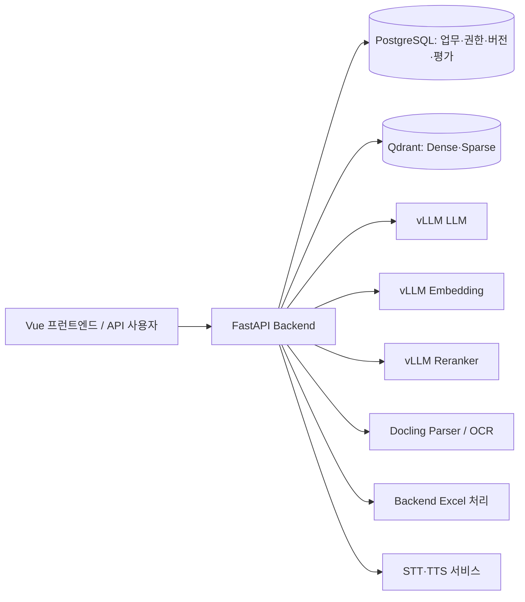

# Advanced RAG Framework

문서 수집·구조 기반 청킹·한국어 하이브리드 검색·근거와 사진이 포함된 답변을 제공하는 RAG 시스템입니다. FastAPI 백엔드, Vue 프런트엔드, PostgreSQL, Qdrant와 별도 문서 파서·모델 서버로 구성됩니다.

> 현행 구현 정리 기준: 2026-11-09. 코드 기본값은 환경변수·DB 설정·요청별 지정에 따라 달라질 수 있습니다. 구현된 기능과 실측으로 검증된 성능은 구분합니다.

## 주요 기능

- PDF·Word·PowerPoint·이미지 OCR·Excel 문서 수집
- 법령·매뉴얼·일반·스프레드시트 유형별 파싱·청킹
- Qdrant 서버 측 Dense + Kiwi BM25 sparse 검색 및 가중 RRF
- vLLM Cross-Encoder Reranker와 오류 유형별 Fallback
- LangGraph 기반 질의 처리와 같은 그래프를 사용하는 JSON·SSE 응답
- 출처·페이지·섹션·시트·셀 범위와 연결 사진 제공
- 사용자·부서 접근 제어, 문서 버전 관리·설정 기반 이전 버전 복원
- 관리자·사용자 통계, 질의 결과·토큰·피드백 기록
- 평가 데이터셋 생성·검수·골드셋 확정·검색/Full 평가·비교·Excel 다운로드
- Protocol·컨테이너·레지스트리를 이용한 주요 구현체 교체
- STT·TTS API 연동 경로와 별도 모델 실행 스크립트

사진 추출·출처 연결과 VLM의 도면 의미 이해는 별개입니다. 기본 검색은 텍스트 임베딩 기반이며 이미지 자체 유사도 검색이나 도면 의미 이해의 품질이 검증되었다는 뜻은 아닙니다.

## 시스템 구성



| 영역 | 역할 |
|---|---|
| Backend | CPU 기반 API·업무 로직·그래프·적재 관리 |
| PostgreSQL | 사용자·권한·문서·버전·작업·질의·평가 데이터 |
| Qdrant | Dense·Kiwi BM25 sparse 벡터와 검색 payload |
| Docling Parser | 별도 서버의 문서 구조 변환·표·OCR |
| vLLM | LLM·임베딩·Reranker를 별도 프로세스·포트로 서빙 |
| Frontend | 채팅·문서 관리·설정·통계·평가 화면 |

앱 DB는 PostgreSQL입니다. 일부 코드의 `sqlite_db_path` 인수와 관련 주석은 이전 구현의 호환 이름으로 남아 있으므로 현재 앱 DB가 SQLite라는 의미로 해석하지 않습니다.

## 빠른 시작

### 사전 요구사항

- Docker·Docker Compose 또는 Python 3.12 기반 로컬 개발 환경
- 프런트엔드 실행용 Node.js·npm
- 접근 가능한 PostgreSQL·Qdrant·LLM·임베딩·Reranker 서비스
- 문서 유형에 필요한 Docling 파서 또는 로컬 파싱 의존성
- GPU 모델·OCR을 직접 구동할 경우 해당 NVIDIA 드라이버와 런타임

개발 Compose는 **Backend + PostgreSQL + Qdrant**를 실행합니다. 모델·Docling·프런트엔드는 포함하지 않습니다. 외부 GPU 서버를 사용하는 백엔드 개발 PC 자체에는 GPU가 필요하지 않습니다.

아래 명령은 저장소의 WSL 개발 환경에 맞춰 `docker-compose`로 표기합니다. Compose 플러그인을 쓰는 환경에서는 `docker compose`로 바꿉니다.

### 1. 환경 설정

저장소 루트에서 실행합니다.

```bash
cp .env.example .env
```

`.env.example`의 필수 빈칸을 채웁니다. 값이 비어 있는 숫자·불리언 항목은 설정 오류를 일으킬 수 있습니다. `.env`와 비밀번호·키는 저장소에 포함하지 않습니다.

| 설정 그룹 | 확인할 항목 |
|---|---|
| 업무 DB | `POSTGRES_HOST`, `POSTGRES_PORT`, `POSTGRES_DB`, `POSTGRES_USER`, `POSTGRES_PASSWORD`, `POSTGRES_TEST_DB` |
| 벡터 DB | `QDRANT_HOST`, `QDRANT_PORT` |
| LLM | `VLLM_API_URL`, `VLLM_MODEL_NAME`, 인증·입출력 길이·생성 설정 |
| 임베딩 | `EMBEDDING_API_URL`, `EMBEDDING_MODEL_NAME`, `EMBEDDING_DIM`, 입력 길이 |
| Reranker | `ENABLE_RERANKING`, `RERANKER_API_URL`, 모델·인증 설정 |
| 문서 파서 | `DOCLING_PARSER_HOST`, 인증·대기 시간, `EXCEL_PARSE_MODE` |
| 검색·청킹 | `SPARSE_ENCODER_TYPE`, 청크 크기·겹침·전처리 관련 필수값 |
| 자원 | `RESOURCE_STORAGE_ROOT`, 내부 인증·용량·보관·전달 설정 |
| 인증·웹·로그 | JWT·CORS·로그 수준 및 보관 설정 |

기본 Qdrant hybrid 검색에서는 `SPARSE_ENCODER_TYPE=none`이어도 Kiwi BM25 검색을 사용합니다. 이 값은 별도 BM42/SPLADE 인코더의 활성 여부를 제어합니다.

개발 관리자 자동 생성을 사용할 경우 다음 값을 명시합니다.

```dotenv
DEV_BOOTSTRAP_ADMIN=true
DEV_BOOTSTRAP_ADMIN_ID=admin
```

`ADMIN_PASSWORD`도 10자 이상으로 설정해야 합니다. 활성 관리자가 없을 때만 생성하며 운영 DB에서는 자동 생성을 거부합니다.

개발 Compose가 `EXCEL_PARSE_MODE`를 전달하므로 `.env`에 사용할 모드를 명시합니다. `backend`는 Excel 전용 처리, `docling`은 파서 서버 경로입니다. 개발 이미지에는 LibreOffice가 없어 `.xls` 변환 도구를 별도 준비해야 합니다.

환경 파일은 실행의 기본 입력입니다. 관리자 저장 설정은 `get_runtime_settings()`에서 추가 반영하므로 모든 실행값이 `.env`에만 있는 구조는 아닙니다.

### 2. 개발 백엔드·DB 실행

```bash
docker-compose -f docker-compose.dev.yml up -d --build
docker-compose -f docker-compose.dev.yml logs -f backend
```

백엔드는 `init_database.py`로 Alembic 마이그레이션을 적용한 뒤 서버를 실행합니다.

```bash
curl http://localhost:8081/health
```

개발 관리자 비밀번호 변경:

```bash
docker exec -it rag-backend-dev python scripts/create_admin.py --user-id admin --reset-password
```

### 3. 프런트엔드 실행

별도 터미널에서 실행합니다. 개발 서버의 `/api`는 `localhost:8081`로 전달됩니다.

```bash
cd adrag_frontend
npm install
npm run dev
```

| 서비스 | 개발 접속 |
|---|---|
| 프런트엔드 | http://localhost:3000 |
| Backend API 문서 | http://localhost:8081/docs |
| Qdrant 대시보드 | http://localhost:6333/dashboard |
| PostgreSQL | localhost:5432, `.env`의 DB·계정 |
| 모델·파서 | `.env`에 지정한 별도 서비스 |

### 4. 백엔드를 로컬 Python으로 실행

개발 DB 컨테이너를 실행하고 로컬 프로세스에서 접근할 DB·Qdrant 주소를 설정합니다.

```bash
docker-compose -f docker-compose.dev.yml up -d postgres-dev qdrant-dev
cd adrag_backend
python -m venv venv
```

가상환경 활성화는 Windows PowerShell에서 `venv\Scripts\Activate.ps1`, Linux/WSL에서 `source venv/bin/activate`를 사용합니다.

```bash
python -m pip install -r requirements.txt
python init_database.py
uvicorn main:app --host 0.0.0.0 --port 8081 --reload
```

Docling·모델 서비스 및 CPU PyTorch·문서 변환 도구 등 플랫폼별 의존성은 별도 준비합니다. 같은 8081 포트의 Compose backend와 로컬 backend를 동시에 실행하지 않습니다.

### 5. 운영 배포

루트 운영 Compose의 서비스는 `backend`, `postgres`, `qdrant`입니다.

```bash
docker-compose build
docker-compose up -d
```

운영 Compose backend는 `127.0.0.1:8081`로 바인딩됩니다. 프런트엔드·리버스 프록시·모델·파서는 별도 구성하며 실제 서버별 배포는 [운영 배포 가이드](docs/design/운영배포_가이드_서버별_v1.1.md)를 따릅니다.

운영 관리자는 최초 1회 수동 생성합니다.

```bash
docker exec -it adrag_backend python scripts/create_admin.py --user-id <아이디> --name <이름>
```

## 검색·답변 처리

```text
입력 검증 → 가드레일 → 질문 분석·재작성 → 권한·문서 범위 필터
 → Dense + Kiwi BM25 sparse → Qdrant 가중 RRF → 메타데이터 보강
 → 중복 제거·Reranker → 관련성 판단 → 컨텍스트·이미지 후보
 → 답변 생성 → 인용·사진 정리 → 응답
```

일반 질의는 `ainvoke()`, 스트리밍은 같은 그래프의 `astream_events()`를 사용합니다. 스트리밍 서비스는 그래프 이벤트를 진행 상태·토큰·인용·이미지·종료 SSE로 변환합니다.

### 검색 기본값과 선택 경로

| 항목 | 코드 기본값 / 구현 |
|---|---|
| 검색 엔진 | `retrieval_engine=qdrant_hybrid` |
| Dense | 코사인 유사도, 여러 재작성 질문 반영 |
| Sparse | Kiwi 토큰화 + `qdrant/bm25`, named vector `kiwi_bm25` |
| BM25 | `k1=1.2`, `b=0.5`, `avg_len=128` |
| 병합 | 서버 측 가중 RRF, `k=60` |
| 사전 후보 | Dense 질문별 / Sparse 각각 최소 80개 |
| 단계별 수 | 검색 40 → 재정렬 반환 10 → 컨텍스트 최대 6 |
| 관련성 | CE 임계값 0.25, 재검색 시 0.1 |
| 컨텍스트 다양성 | 문서당 기본 최대 2개 청크 |
| 재시도 | 기본 최대 1회 |

Reranker는 검색 후보들을 채점한 뒤 상위 결과를 반환합니다. `reranker_top_k=10`이 입력 10개만 채점한다는 의미는 아닙니다. CE 점수는 정답 확률로 해석하지 않습니다.

법령·메뉴 질문은 Kiwi BM25, 개념·서술형 질문은 Dense에 높은 가중치를 부여합니다. 가중치와 임계값은 평가셋으로 검증·조정할 초기값입니다.

Legacy에는 Python BM25 및 `dense_kiwi`, `dense_bm42`, `dense_kiwi_bm42` 프로필이 있습니다. BM42는 FastEmbed, SPLADE는 별도 `/encode` API 연동입니다. **기본 qdrant_hybrid에서 프로필만 변경해 BM42가 추가되는 것은 아닙니다.**

### Fallback

| 원인 | 처리 |
|---|---|
| 관련성 부족 | 검색 후보·재정렬 반환 수 확대, 원 질문 사용, 임계값 완화 |
| Reranker 장애 | 검색 순위 상위 일부 사용, CE 임계값 비교 우회 |
| 답변 생성 오류 | 확보한 컨텍스트로 생성 재시도 |
| 검색 시스템 오류 | 검색 오류로 종료 |
| 근거 부족 지속 | 관련 정보 없음 안내 |

다른 검색 DB로 자동 전환하는 Fallback은 확인되지 않았습니다. Reranker 장애 경로는 정상 재정렬 경로와 품질을 따로 평가해야 합니다.

## 문서 파싱·적재

- Docling 기본 로더와 PDF용 pdfplumber 선택 경로
- 스캔 PDF 판별 후 한국어·영어 EasyOCR GPU 처리, TableFormer 표 구조 인식
- 문서 유형별 청커와 페이지·섹션·시트·셀 범위 메타데이터
- Excel OpenPyXL 구조 파싱·IR 기반 청킹과 backend 전용 Excel 경로
- 사진 자원 추출·저장·청크 연결·출처 연결
- 단계별 체크포인트·재개·실패 보상, 문서 버전·활성 버전 검색 연동

```text
IngestService → IngestPipeline
  ParseStep: 원본 저장·컬렉션 확인
  ChunkStep: 파일 라우팅·실제 파싱·청킹·자원 연결
  EmbedStep: 임베딩
  IndexStep: 벡터·업무 데이터·자원·버전 반영
```

백엔드의 `EXCEL_PARSE_MODE`와 파서 서버의 `EXCEL_PARSER`는 별도 설정입니다. 전자는 backend 전용 경로와 파서 서버 경로, 후자는 파서 서버 내부 OpenPyXL/Docling 선택입니다.

스캔 판별은 표본 검사이며 혼합 PDF를 완벽히 판별하지는 않습니다. Word 페이지 번호는 실제 인쇄 페이지와 다를 수 있습니다. 한 SOP에서 여러 연속 근거가 필요한 질문은 문서당 청크 제한의 영향을 확인해야 합니다.

## 모듈화 구조

현재는 **주요 컴포넌트에 교체 경계를 둔 모듈형 백엔드**입니다. 전체가 독립 플러그인·SDK로 분리된 구조는 아닙니다.

### 컨테이너·인터페이스·의존성

| 구성 | 역할 |
|---|---|
| [container.py](adrag_backend/app/core/container.py) | 질의용 주요 객체 조립·지연 생성·재사용 |
| [interfaces/](adrag_backend/app/interfaces/__init__.py) | 구현체의 메서드·입출력 계약 |
| [GraphDependencies](adrag_backend/app/graphs/dependencies.py) | Settings와 PipelineContainer를 노드에 전달 |
| [PipelineState](adrag_backend/app/graphs/state.py) | 요청별 질문·검색 결과·컨텍스트·답변·오류 상태 |
| [rag_graph.py](adrag_backend/app/graphs/rag_graph.py) | 12개 노드와 조건 분기 연결 |
| [registry.py](adrag_backend/app/core/registry.py) | LLM 팩토리 등록·최종 답변 provider 선택 |
| [processor.py](adrag_backend/app/parsers/processor.py) | 파서·청커 레지스트리와 문서 처리 조립 |
| [evaluation/ports.py](adrag_backend/app/evaluation/ports.py) | 평가 관점의 검색·LLM·임베딩·파이프라인 계약 |

`PipelineContainer`는 Docker 컨테이너가 아닌 Python 객체 조립 지점입니다.

```text
Settings → PipelineContainer
  ├─ embedding                 EmbeddingProvider / EmbeddingClient
  ├─ vector_store              VectorStore / VectorRepository
  ├─ reranker                  Reranker / RerankerClient
  ├─ query_preprocessor        QueryPreprocessorProtocol
  ├─ sparse_encoder            SparseEncoder
  ├─ kiwi_bm25_encoder         KiwiBm25Encoder
  ├─ retrieval_orchestrator    Legacy 채널 조립
  ├─ collection_service        컬렉션 검증·관리
  └─ local_llm                 별도 로컬 LLM 싱글턴 참조
```

대부분 `cached_property`로 컨테이너 인스턴스별 최초 접근 때 생성합니다. `get_container()`는 전역 컨테이너를 재사용하지만 기본 그래프 의존성은 런타임 설정으로 새 컨테이너를 만듭니다. 모든 기능이 단일 전역 컨테이너 하나만 공유하지는 않습니다.

### 인터페이스와 교체 방법

| 계약 | 주요 호출 | 교체 지점 |
|---|---|---|
| EmbeddingProvider | embed_query / embed_queries / embed_texts / health_check | 컨테이너 임베딩 팩토리 |
| Reranker | rerank → `(원본 인덱스, 점수)` 목록 | 컨테이너 Reranker 팩토리 |
| VectorStore | Dense·BM25·Sparse·Hybrid, 일부 관리·적재 | 컨테이너 + Qdrant 종속 호출부 |
| LLMProvider | chat / chat_stream | register_llm_provider |
| DocumentParser | load → 페이지별 원문·메타데이터 | register_parser |
| Chunker | `(docs, config) → chunks` Callable | register_chunker |
| QueryPreprocessorProtocol | preprocess | 컨테이너 전처리기 |

현재 팩토리 기본 등록은 임베딩 `vllm`, 벡터 저장소 `qdrant`, Reranker `vllm`입니다. 없는 provider 이름을 설정하는 것만으로 신규 구현이 생기지는 않습니다.

LLM·파서·청커는 별도 레지스트리를 사용합니다. 최종 답변은 `resolve_llm_from_state()`가 선택하며 내부 가드레일·재작성은 `container.local_llm`을 사용합니다. **local_llm 속성만 교체해 최종 답변 모델까지 모두 변경되는 구조는 아닙니다.**

### 기능별 재사용

| 필요한 기능 | 진입점 | 필요한 의존성 |
|---|---|---|
| 임베딩만 | EmbeddingClient / container.embedding | 설정·HTTP·모델 서버 |
| 재정렬만 | RerankerClient / container.reranker | 설정·HTTP·모델 서버 |
| 질문 전처리 | QueryPreprocessor | Kiwi·사전·유틸리티 |
| 파싱·청킹만 | DocumentChunkingProcessor | 로더·변환·설정·문서 유형, 필요 시 파서 서버 |
| 개별 검색 단계 | retrieve(state, deps) | 컬렉션·권한 필터·버전·벡터·임베딩 |
| 주입한 RAG 그래프 | build_rag_graph(GraphDependencies(...)) | 상태 및 그래프 내부 업무 의존성 |
| 전체 사용자 질의 | RAGService / 기존 API | 세션·권한·DB·검색·모델·자원 |
| 평가 지표만 | evaluation/metrics | 지표별 입력·필요한 임베딩 |

그래프에 의존성을 전달하는 형태:

```python
from app.core.container import PipelineContainer
from app.core.runtime_settings import get_runtime_settings
from app.graphs.dependencies import GraphDependencies
from app.graphs.rag_graph import build_rag_graph

settings = get_runtime_settings()
container = PipelineContainer(settings)
graph = build_rag_graph(GraphDependencies(settings, container))
# initial_state는 app.graphs.state.make_initial_state()로 구성한다.
# async 함수에서: result = await graph.ainvoke(initial_state)
```

노드 직접 호출은 앞선 인증·가드레일·권한 필터를 자동 실행하지 않습니다. 다른 앱에서 전체 운영 기능을 쓰려면 기존 API 호출이 의존성을 가장 적게 가져갑니다.

### 현재 분리의 한계

- IngestService는 임베딩·Sparse·벡터 저장소를 별도 조립하므로 질의 컨테이너 변경이 적재까지 자동 적용되지는 않습니다.
- VectorStore에 Qdrant 자료형·필터·PointStruct·버전 정책 의존성이 남아 있어 DB 교체는 어댑터 하나만으로 끝나지 않습니다.
- 일부 Protocol은 Any·가변 인수로 계약이 느슨하고 Excel 로더에는 추가 `document_id` 호출 계약이 있습니다.
- 권한·컬렉션·사진·평가 저장소의 직접 생성이 남아 있습니다.
- 런타임 설정으로 그래프를 재생성해도 별도 로컬 LLM 싱글턴의 설정까지 자동 갱신되는 것은 아닙니다.
- 평가 ports/adapters는 존재하지만 generator·runner의 구체 어댑터·DB 의존성을 추가 분리해야 독립 서비스화할 수 있습니다.

입출력·객체 수명·교체 및 실행 예제는 [모듈화 상세 분석](docs/design/RAG_모듈화_컨테이너_인터페이스_구조분석_20261109.md)을 참조합니다.

### 공통 HTTP 연결 관리: app/core/http.py

[http.py](adrag_backend/app/core/http.py)는 모델 클라이언트들이 사용하는 프로세스 전역 `httpx.AsyncClient`를 관리합니다. 컨테이너의 객체 조립과 별도로 HTTP 연결을 재사용하는 계층입니다.

| 항목 | 현재 구현 |
|---|---|
| 생성 | get_shared_async_client()로 최초 접근 시 생성, 닫혔으면 재생성 |
| 기본값 | timeout 120초, 최대 연결 100, keep-alive 연결 최대 20 |
| 요청별 지정 | 임베딩·Reranker·LLM·ASR은 각 timeout·URL·headers 사용, SPLADE는 30초 |
| 사용처 | 임베딩·Reranker·LLM·OpenAI 호환 호출·SPLADE·ASR·의미 보강 |
| 종료 | close_shared_async_client(), main.py lifespan에서 호출 |
| 별도 경로 | Docling 로더·파서 자원 회수는 requests, Qdrant·PostgreSQL은 각 SDK·DB 풀 |

http.py 자체는 재시도·업무 Fallback을 수행하지 않습니다. 클라이언트가 응답을 해석하고 그래프가 실패 정책을 적용합니다. 연결 수는 모델 동시 처리량 보장이 아니며 기본 timeout도 요청 전체 실행시간의 절대 상한과 구분해야 합니다.

독립 스크립트에서는 최상위 실행 종료 시 HTTP 풀을 닫고, 앱 요청마다 공유 클라이언트를 닫지 않습니다. 함수별 동작·호출 흐름·사용처·스트리밍·종료 순서는 [모듈화 상세 분석의 공통 HTTP 절](docs/design/RAG_모듈화_컨테이너_인터페이스_구조분석_20261109.md#61-공통-http-모듈-appcorehttppy)에 정리했습니다.

## 검색 평가와 실증

```text
청크 표본 추출 → QA 후보 생성 → 검색 self-validation → 관리자 검수
 → 승인 항목 골드셋 확정 → 검색 또는 Full 평가 → 집계·비교·다운로드
```

자동 생성 유형은 사실·절차·비교·멀티홉입니다. 기대 동작으로 정상 답변·정보 부족·가드레일·권한 거절을 지정할 수 있으며 부정 사례는 별도 구성해야 합니다.

지표는 Recall@K·MRR·NDCG·문서 단위 검색, 답변 유사도·문장 정렬·F2·LLM Judge, 인용·Fallback·시간·토큰·오류/제외 건수입니다. 답변 주 지표는 기본 F2이며 미계산 시 대체 순서를 사용합니다. 여러 지표 중 최고점을 선택하는 방식은 아닙니다.

### CLI 검색 비교

`adrag_backend`에서 실행합니다. 현재 컬렉션과 일치하는 청크 ID를 가진 검수 완료 골든셋이 필요합니다.

```bash
python -m offline_evaluation retrieval --golden offline_evaluation/data/test/korean_search_golden.json --mode dense_only --top-k 10 --out offline_evaluation/results/dense
python -m offline_evaluation retrieval --golden offline_evaluation/data/test/korean_search_golden.json --mode hybrid_retrieval --top-k 10 --out offline_evaluation/results/hybrid
python -m offline_evaluation retrieval --golden offline_evaluation/data/test/korean_search_golden.json --mode hybrid_rerank --top-k 10 --rerank-k 5 --out offline_evaluation/results/rerank
```

### 결과 해석 시 확인할 차이

- 검색되지 않는 자동 생성 질문을 한 번 재생성하므로 현재 검색기에 유리한 편향이 생길 수 있습니다.
- 검색 단독 평가는 원 질문을 사용하고 Full 평가는 그래프를 실행합니다.
- 평가 기본 후보 수와 운영 기본 후보 수가 다를 수 있습니다.
- Full 평가에는 운영 스트리밍과 다른 누락 인용 보정이 있습니다. 원본·보정 후 점수를 구분해야 합니다.
- 고정 평가 사용자로 실행하는 그래프 평가는 실제 사용자별 인증·권한 API 시험을 대체하지 않습니다.

보관된 2026-06-26 결과는 56건 Recall@10 87.50%, 60건 별도 평가 81.67%이며 인용 지표는 각각 37.50%, 36.67%였습니다. **이후 검색·인용 구현이 변경되었으므로 현재 버전이나 최신 SOP 실증 성능으로 제시하지 않습니다.**

실증에서는 실제 작업 질문·유사 모델·버전·사진·오탈자·STT 오류·정보 부족·권한 밖 사례를 포함하고 튜닝셋과 최종 시험셋을 분리합니다. 동일 문서·설정에서 검색 방식 비교와 운영 API 평가, 적재 병행 부하의 P95/P99·오류·GPU 메모리 측정을 구분합니다.

## 모델 서빙·GPU와 모델 교체

### 운영 배포 스크립트 기준

| 서비스 | 모델 | GPU | 포트 | 주요 설정 |
|---|---|---:|---:|---|
| LLM | Qwen3.5-9B | 0 | 8101 | BF16, 24,576 토큰, 최대 시퀀스 16, 메모리 비율 0.70 |
| 임베딩 | Qwen3-Embedding-4B | 1 | 8102 | Pooling, 입력 8,192, 비율 0.18 |
| Reranker | bge-reranker-v2-m3 | 1 | 8103 | Pooling, FP16, 비율 0.05 |
| Docling·OCR | 문서 파싱 | 0 | 별도 | LLM과 GPU 공유 |

각 모델은 별도 프로세스입니다. 위 포트는 [운영 GPU 스크립트](deploy/gpu/opt/yest/chatbot/vllm/app/run-llm.sh) 기준이며 [개발 통합 스크립트](vllm/app/run_adrag_model_v2.sh)는 GPU 0의 8001/8002/8003을 사용합니다. backend URL·served model name과 맞춰야 합니다.

2026-11-05 사용 현황 문서에는 H100 80GB 2장 사용이 기록되어 있습니다. GPU 0은 LLM·파서 약 58.4GB, GPU 1은 임베딩·Reranker·ASR 약 24.4GB입니다. 이번 README 정리에서 재측정한 값이 아니며 모델 가중치의 최소 필수량도 아닙니다.

L40S 48GB 한 장은 **핵심 모델 3개의 입력 길이·동시성·배치를 조정해 시험할 수 있는 후보 구성**입니다. 현재 운영 설정·처리량이나 ASR·TTS·VLM·OCR까지 모두 상주하는 구성을 보장하지 않습니다. 메모리 비율은 GPU 연산 자원 격리 비율도 아닙니다.

### 모델을 바꾸는 절차

1. 모델 서버에서 실제 모델·served name·입력 길이를 설정합니다.
2. backend의 URL·모델명·인증·입출력 제한을 맞춥니다.
3. API 계약이 같으면 클라이언트 설정을 변경하고 다르면 Protocol 구현체·팩토리를 추가합니다.
4. 임베딩은 차원·정규화·질의 prefix와 기존 색인 호환성을 확인하고 필요 시 재색인합니다.
5. 질의 컨테이너와 적재 서비스의 별도 생성 경로를 모두 확인합니다.
6. Reranker 점수 척도·관련성 임계값, LLM 컨텍스트 예산과 품질을 재평가합니다.

환경변수의 모델명만 바꾸면 실제 서버 모델과 기존 인덱스까지 자동 교체되는 것은 아닙니다. 문서·사진은 사내 처리 정책에 따라 로컬 모델을 사용하며 외부 provider 연결 코드의 존재가 외부 API 사용 승인을 의미하지 않습니다.

## pgvector와 비교

현재 프로젝트에서는 기존 검색·컬렉션·권한·버전·적재 연동과 전환 비용을 고려해 Qdrant 유지가 합리적입니다. 다만 pgvector보다 품질·속도가 우수하다는 동일 조건 비교 결과는 확인되지 않았습니다.

| 관점 | 현재 Qdrant | pgvector 전환 검토 |
|---|---|---|
| 검색 구성 | Kiwi sparse·Dense·가중 RRF 구현 완료 | 동등한 토큰화·키워드·RRF 구성 필요 |
| 부하 | 업무 DB와 검색 분리 | PostgreSQL 자원 공유 |
| 일관성 | PostgreSQL·Qdrant 간 관리 필요 | 메타데이터·벡터 트랜잭션 통합 가능 |
| 운영 | 별도 벡터 DB 관리 | 저장소·백업 체계 단순화 가능 |
| 검증 | 기존 기능 회귀 검증 | 차원·필터·후보·지연·갱신 비교 필요 |

pgvector도 전문 검색·RRF·Cross-encoder를 결합할 수 있습니다. 2,560차원을 사용하는 경우 일반 vector HNSW의 2,000차원 한도와 halfvec 등 대안을 확인해야 합니다. 실제 컬렉션 차원은 설정·저장 데이터 기준으로 확인합니다.

근거와 L40S 산정·평가 편향·비교 조건은 [검색·평가·GPU·pgvector 상세 분석](docs/design/RAG_구현현황_평가_GPU_pgvector_비교분석_20261109.md)에 정리했습니다.

## 프로젝트 구조

```text
advanced-rag-voucher/
├── adrag_backend/
│   ├── app/
│   │   ├── core/             # 설정·컨테이너·LLM 레지스트리·HTTP 풀
│   │   ├── interfaces/       # 컴포넌트 계약
│   │   ├── graphs/           # 상태·노드·분기·검색 채널·그래프
│   │   ├── clients/          # 모델 서버·Sparse 인코더
│   │   ├── routes/           # HTTP API
│   │   ├── services/         # RAG·적재·문서·통계·자원 업무
│   │   ├── repositories/     # PostgreSQL·Qdrant 저장 접근
│   │   ├── parsers/          # 로더·판정·변환·청커
│   │   ├── ingest/           # Excel·청크·사진·레코드 변환
│   │   ├── evaluation/       # ports·adapters·dataset·metrics·runner
│   │   ├── prompts/          # 프롬프트 구성
│   │   ├── models/           # API·업무 모델
│   │   └── utils/            # 보안·로그·Kiwi 등
│   ├── excel_ingest/         # Excel 전용 추출
│   ├── offline_evaluation/   # CLI 평가·골든셋·기록 결과
│   ├── migrations/           # Alembic revision
│   ├── scripts/              # 관리자·검증·이관 도구
│   ├── tests/                # 단위·통합·E2E
│   ├── main.py               # API 등록·시작·종료
│   └── init_database.py      # 마이그레이션·초기화
├── adrag_frontend/           # Vue 채팅·관리·통계·평가
├── docling-parser/           # 별도 문서 파서 서버
├── vllm/                    # 개발 모델 실행
├── deploy/                  # 서버별 운영 배포
├── docs/                    # 설계·분석·운영 문서
├── docker-compose.yml       # Backend·PostgreSQL·Qdrant
├── docker-compose.dev.yml   # 개발 Backend·PostgreSQL·Qdrant
└── .env.example             # 환경 설정 견본
```

## 개발 검증

백엔드 테스트는 별도 PostgreSQL 테스트 DB를 사용합니다. `TEST_DATABASE_URL` 또는 테스트 DB 설정을 준비하고 같은 테스트 DB에 여러 pytest를 동시에 실행하지 않습니다.

```bash
cd adrag_backend
pytest -q -m "not e2e and not voice"
```

개발 컨테이너를 사용할 경우:

```bash
docker exec -it rag-backend-dev pytest -q -m "not e2e and not voice"
```

E2E·음성 테스트는 실행 중인 서비스와 별도 설정이 필요합니다. Protocol·레지스트리·채널·스트리밍·적재 검증은 관련 tests에 있으며 메서드 존재 검사가 실제 서버·검색 품질 검증을 대체하지는 않습니다.

프런트엔드 빌드:

```bash
cd adrag_frontend
npm run build
```

## 상세 문서

- [RAG 구현·평가·GPU·pgvector 비교 분석](docs/design/RAG_구현현황_평가_GPU_pgvector_비교분석_20261109.md)
- [모듈화·컨테이너·인터페이스·기능별 재사용 분석](docs/design/RAG_모듈화_컨테이너_인터페이스_구조분석_20261109.md)
- [서버별 운영 배포](docs/design/운영배포_가이드_서버별_v1.1.md)
- [수정 배포](docs/design/운영배포_수정배포_가이드_v1.1.md)
- [운영 설정 목록](deploy/운영설정_목록.md)
- [GPU 사용 현황 기록](docs/design/GPU_사용현황_메일_20261105.md)
- [Docling 파서](docling-parser/README.md)
- [Backend Excel 추출](adrag_backend/excel_ingest/README.md)
- [오프라인 평가 안내](adrag_backend/offline_evaluation/README.md)
- [로컬 API 문서](http://localhost:8081/docs)

## 라이선스

MIT
