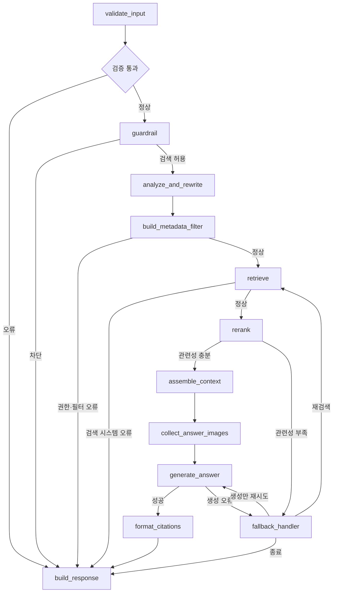

# RAG 모듈화·컨테이너·인터페이스 구조 분석

- 작성일: 2026-11-09
- 대상: 현재 저장소의 backend, parser, evaluation 코드
- 확인 방식: 실제 구현·호출부·관련 테스트를 읽은 정적 분석
- 범위: 구조 설명과 사용 방법 정리. 애플리케이션 코드는 변경하지 않았으며 테스트·외부 서버 호출은 실행하지 않았다.
- 예제: `adrag_backend`를 작업 디렉터리로 사용하는 Python 예제다. 실제 실행에는 프로젝트 의존성과 설정이 필요하다. 외부 모델 예시는 구현 확장점을 설명하며 신규 외부 API 사용을 제안하거나 실행한 것이 아니다.

## 1. 현재 모듈화 수준에 대한 판단

현재 구조는 **하나의 백엔드 안에서 계층을 분리하고, 핵심 파이프라인의 구현체를 일부 교체할 수 있도록 만든 모듈형 모놀리스**로 보는 것이 정확하다.

모듈형 모놀리스는 이 문서의 구조적 판단이며, 모든 모듈 경계가 강제로 격리되었다는 의미는 아니다. 별도 프로세스로 동작하는 Docling 파서와 모델 서빙은 존재하지만, backend 내부 기능 전체가 독립 패키지나 마이크로서비스로 분리된 상태는 아니다.

| 영역 | 현재 수준 | 해석 |
|---|---|---|
| API / 서비스 / 저장소 | 디렉터리와 책임 분리 | 요청 처리와 업무 로직·저장 접근을 구분 |
| RAG 실행 | LangGraph 노드·조건 분기 분리 | 단계별 실행·실패 경로를 개별 관리 |
| 의존성 조립 | PipelineContainer + GraphDependencies | 질의 경로의 주요 구현체를 주입 가능 |
| 임베딩·Reranker | Protocol + 팩토리 | 계약에 맞는 구현체로 바꾸기 비교적 쉬움 |
| LLM | Protocol + 별도 레지스트리 | 답변 모델과 내부 처리 모델의 선택 경로가 다름 |
| 파서·청커 | 자체 레지스트리 | 전체 RAG 없이 파싱·청킹 단위 사용 가능 |
| 적재 | 단계형 파이프라인·체크포인트 | 실행 단계는 나뉘었지만 IngestService 결합이 남음 |
| 평가 | ports / adapters / metrics / runner | 교체 경계가 있으나 DB·구현 어댑터 직접 생성도 남음 |
| 벡터 DB 교체 | 부분 추상화 | Qdrant 자료형·필터·적재·버전 처리까지 손봐야 함 |
| 다른 프로젝트로 복사 | 기능별 난이도 차이 | 폴더 하나를 복사하는 완전 독립 SDK 구조는 아님 |

**핵심은 “함수와 클래스를 분리한 수준을 넘어 교체 지점이 마련되어 있지만, 모든 기능이 container.py와 interfaces만으로 완전히 분리된 것은 아니다”라는 점이다.**

## 2. 전체 디렉터리와 책임

```text
adrag_backend/
  main.py                         앱 시작·종료, API router 등록
  app/
    routes/                       HTTP API, 인증·요청·응답 연결
    services/                     RAG·적재·문서·통계 등 업무 서비스
    graphs/
      rag_graph.py                RAG 노드 연결과 분기 조립
      dependencies.py             그래프 의존성 묶음
      state.py                    실행 상태·초기 상태 생성
      nodes/                      검색·재정렬·생성 등 실행 단계
      edges.py                    조건 분기
      retrieval_engine.py         검색 채널·질문 묶음·RRF·검색 설정
      preprocessing/              질의 정규화·패턴·키워드 분석
    core/
      config.py                   환경 기반 기본 설정
      runtime_settings.py         DB 설정을 반영한 런타임 설정
      container.py                질의용 주요 컴포넌트 조립
      registry.py                 LLM 구현체 등록·선택
      http.py                     공유 HTTP 클라이언트
    interfaces/                   컴포넌트 호출 계약
    clients/                      임베딩·재정렬·LLM 등 서버 호출
    repositories/                 PostgreSQL·Qdrant 등 저장 접근
    parsers/
      processor.py                파서 선택·변환·문서 유형·청킹 조립
      loaders/                    파일을 구조화된 원문으로 로딩
      chunkers/                   법령·매뉴얼·일반·Excel 청킹
      detectors/                  문서 유형 판정
      utils/                      변환·정제
    ingest/                       Excel 라우팅·청크·사진·적재 레코드 변환
    evaluation/
      ports.py                    평가 관점의 추상 계약
      adapters/                   운영 구현을 평가 계약에 맞게 변환
      dataset/                    후보 생성·표본 추출·검증
      metrics/                    평가 지표 계산
      runner/                     실행·집계
    prompts/                      프롬프트 템플릿과 구성
    models/                       API·업무 데이터 모델
    utils/                        공통 유틸리티
  excel_ingest/                   Excel 전용 추출 기능
  offline_evaluation/             CLI 평가 도구

docling-parser/                   별도 문서 파싱 서버
adrag_frontend/                   Vue 사용자·관리자·평가 화면
vllm/, deploy/gpu/                모델 서빙 및 GPU 배포 구성
```

컨테이너는 Docker 컨테이너가 아니라 **필요한 객체를 만들고 연결하는 Python 객체**다. 모델을 GPU에 올리는 기능도 아니다. GPU 모델은 별도 vLLM 프로세스로 구동하고 backend의 클라이언트가 HTTP로 호출한다.

## 3. container.py의 역할과 실제 범위

근거: [container.py](../../adrag_backend/app/core/container.py)

### 3.1 무엇을 해결하는가

검색 노드별로 임베딩·벡터 저장소·Reranker 객체 생성 코드가 흩어지는 것을 줄이고, 주요 조립 지점을 `PipelineContainer`로 모았다.

```text
Settings
  → PipelineContainer
      ├─ embedding
      ├─ vector_store
      ├─ sparse_encoder
      ├─ kiwi_bm25_encoder
      ├─ retrieval_orchestrator
      ├─ collection_service
      ├─ query_preprocessor
      ├─ reranker
      └─ local_llm
```

### 3.2 속성별 구현과 수명

| 속성 | 노출 타입 / 구현 | 생성·재사용 방식 | 주의점 |
|---|---|---|---|
| settings | Settings | 생성자 인수 또는 get_settings() | 컨테이너의 설정 기준 |
| embedding | EmbeddingProvider / EmbeddingClient | cached_property | 현재 팩토리는 vllm만 등록 |
| vector_store | VectorStore / VectorRepository | cached_property | 현재 팩토리는 qdrant만 등록 |
| sparse_encoder | SparseEncoder | cached_property | 구체 타입이며 none/bm42/splade 분기 |
| kiwi_bm25_encoder | KiwiBm25Encoder | cached_property | Qdrant BM25 Document 자료형 사용 |
| retrieval_orchestrator | RetrievalOrchestrator | cached_property | Legacy 검색 경로용 |
| collection_service | CollectionService | cached_property | 내부 업무 DB 의존성이 남음 |
| query_preprocessor | QueryPreprocessorProtocol / QueryPreprocessor | cached_property | 직접 생성, 별도 provider 팩토리는 없음 |
| reranker | Reranker / RerankerClient | cached_property | 현재 팩토리는 vllm만 등록 |
| local_llm | LLMProvider / 로컬 LLMService | property → 별도 전역 싱글턴 | 컨테이너 설정으로 새로 생성하지 않음 |

`cached_property`는 **해당 컨테이너 인스턴스에서 처음 접근할 때 생성하고 이후 같은 객체를 반환**한다. 모든 요청에서 무조건 새로 만들거나, 프로그램 시작 때 모든 모델 클라이언트를 한꺼번에 만드는 방식이 아니다.

컨테이너 객체가 만들어졌다고 GPU 모델이 적재되는 것은 아니지만, 속성에 접근하면 구현체에 따라 Qdrant 클라이언트 초기화나 BM42 로컬 모델 로딩 등이 발생할 수 있다.

### 3.3 설정으로 선택 가능한 구현체

```text
embedding_provider     = vllm
vector_store_provider  = qdrant
reranker_provider      = vllm
```

이 세 설정은 각각 `_EMBEDDING_FACTORIES`, `_VECTOR_STORE_FACTORIES`, `_RERANKER_FACTORIES`를 조회한다.

**다른 이름을 설정하는 것만으로 신규 구현이 생기지는 않는다.** 현재 없는 provider는 구현 클래스를 작성하고 컨테이너의 팩토리에 등록해야 한다. 이 세 컴포넌트에는 LLM처럼 공개 `register_*` 함수가 없다.

### 3.4 컨테이너는 하나만 존재하는가

두 가지 생성 경로가 있다.

1. `get_container()`는 모듈 전역 `_container`를 지연 생성해 재사용한다.
2. `default_graph_dependencies()`는 런타임 설정으로 **새 PipelineContainer를 생성**한다.

따라서 “전체 프로그램의 모든 기능이 단일 컨테이너 하나를 공유한다”는 설명은 부정확하다. 그래프에 주입된 컨테이너와, `deps` 없이 호출할 때 사용하는 전역 컨테이너는 다를 수 있다. 프로세스가 여러 개면 전역 객체도 프로세스별로 별도다.

## 4. interfaces/의 계약

근거: [interfaces 패키지](../../adrag_backend/app/interfaces/__init__.py)

대부분 `typing.Protocol`과 `runtime_checkable`로 정의되어 있다. 기존 클래스가 명시적으로 인터페이스를 상속하지 않아도 필요한 메서드를 제공하면 구조적으로 사용할 수 있다.

인터페이스 자체는 실행 구현이 없으므로 `interfaces/`만 복사해 기능을 실행할 수는 없다. 구현체·설정·호출부가 함께 필요하다. 런타임 `isinstance` 확인도 모든 인수형·반환형·의미적 동작을 완전히 검증하지는 않는다.

| 인터페이스 | 주요 계약 | 반환 / 특징 |
|---|---|---|
| EmbeddingProvider | async embed_query, embed_queries, embed_texts, health_check | 벡터 또는 벡터 목록 |
| Reranker | async rerank(query, documents, top_k) | 점수순 `(원본 인덱스, 점수)` 목록 |
| LLMProvider | async chat, chat_stream | chat은 choices/usage 호환 응답, stream은 문자열 비동기 생성기 |
| VectorStore | search_similar, search_bm25, search_sparse, search_kiwi_bm25, search_hybrid | `(chunk_id, score, payload)` 목록 |
| VectorStore 관리 계약 | ensure_collection, upsert_points, delete_by_document_id, delete_collection | 컬렉션·인덱싱·삭제 |
| DocumentParser | load(file_path) | 페이지별 text / metadata 목록 |
| Chunker | Callable(docs, config) | 청크 문서 목록 |
| QueryPreprocessorProtocol | preprocess(query) | normalized_query / expanded_terms / matched_patterns / extracted_keywords 등 |

### 4.1 계약의 장점

- 노드에서 임베딩 서버나 Reranker 구현 세부사항을 줄일 수 있다.
- 서버 없이 Fake 구현으로 일부 기능을 검증할 수 있다.
- 입력·출력을 맞춘 어댑터로 새 구현을 연결할 수 있다.
- 외부 SDK 응답 형식과 내부 파이프라인 형식을 분리할 기준이 된다.

### 4.2 현재 계약의 한계

- `VectorStore.search_hybrid(*args, **kwargs)`는 상세 인수 계약이 느슨하다.
- `search_kiwi_bm25(query: Any)`와 `upsert_points(points: List[Any])`는 Qdrant 의존 자료형을 숨기지만 제거하지는 않는다.
- `VectorStore`의 상단 주석은 검색 전용이라고 설명하지만 실제로는 관리·적재 메서드도 포함되어 있다.
- `VectorStore.ensure_collection()`은 Protocol에서 bool 반환으로 선언되어 있으나 실제 VectorRepository 구현은 None 반환으로 선언되어 있어 계약 정리가 필요하다.
- DocumentParser 계약은 `load(file_path)`지만 Excel 호출부는 `document_id=`도 전달한다. Excel까지 대체하려면 이 추가 호출 계약을 처리해야 한다.
- Chunker는 Protocol 클래스가 아닌 Callable 별칭이다.
- LLM `chat()`의 반환형은 Any지만 실제 소비자는 choices/usage 구조를 기대하므로 단순 문자열을 반환하면 호환되지 않을 수 있다.
- 전처리 결과도 Any로 선언되어 있어 실제 소비자가 사용하는 필드 구조까지 맞춰야 한다.

즉, **메서드 이름뿐 아니라 반환 데이터·메타데이터·점수 척도까지 맞아야 교체가 가능**하다.

## 5. GraphDependencies와 LangGraph 실행 흐름

근거: [dependencies.py](../../adrag_backend/app/graphs/dependencies.py), [rag_graph.py](../../adrag_backend/app/graphs/rag_graph.py), [state.py](../../adrag_backend/app/graphs/state.py)

### 5.1 의존성과 상태의 구분

```python
@dataclass(frozen=True)
class GraphDependencies:
    settings: Settings
    container: PipelineContainer
```

- `GraphDependencies`: 실행에 사용할 설정·클라이언트 등 도구
- `PipelineState`: 사용자 질문·검색 결과·컨텍스트·답변 등 요청별 데이터

`frozen=True`는 의존성 묶음의 필드 재할당을 막지만 컨테이너 내부나 Settings까지 깊게 불변으로 만드는 것은 아니다.

그래프 빌더는 `partial(retrieve, deps=deps)` 형태로 대부분의 노드에 의존성을 묶는다. `build_response`는 직접 등록한다. 주요 노드는 deps가 없을 때 전역 getter로 돌아가는 호환 경로도 가지고 있다.

### 5.2 실제 그래프



현재 등록 노드는 12개다. 일부 함수 설명과 주석의 11단계·11개 표기는 현 구현과 차이가 있다. 과거 hybrid+BM42 고정이라는 상단 이력도 현재 기본 검색 경로를 설명하는 문장으로 사용하면 안 된다.

### 5.3 요청 데이터 흐름

```text
make_initial_state()
  → original_query, user_id, collection_name
  → preprocess_result, rewritten_queries, filters
  → retrieved_chunks
  → reranked_chunks
  → context_chunks, final_context
  → image_candidates
  → generated_answer, usage
  → citations, answer_images
  → response, timing, outcome_code
```

각 노드는 상태 일부를 담은 dict를 반환하고 그래프가 상태를 갱신한다. 노드 하나만 호출할 때는 호출자가 상태 갱신을 해야 한다.

검색 결과의 공통 중심 자료형은 다음과 같다.

```python
{
    "chunk_id": "...",
    "document_id": "...",
    "text": "...",
    "score": 0.0,
    "metadata": {...},
}
```

같은 `score` 필드라도 검색 직후는 RRF, 재정렬 후는 CE 점수일 수 있다. 독립 재사용 시 점수 의미와 임계값을 맞춰야 한다.

### 5.4 API에서 응답까지

근거: [rag_service.py](../../adrag_backend/app/services/rag_service.py), [main.py](../../adrag_backend/main.py)

```text
프런트엔드 / 외부 API 호출
 → routes/chat.py 또는 routes/query.py
 → RAGService
     ├─ 세션·컬렉션·요청 설정 구성
     ├─ make_initial_state()
     ├─ 현재 그래프 실행
     ├─ 응답 변환
     └─ 질의 로그·이력 저장
 → JSON 또는 SSE 응답
```

일반 질의는 `graph.ainvoke()`를 호출한다. 스트리밍은 같은 그래프의 `astream_events(..., version="v2")`를 사용한다.

스트리밍에서 검색·생성 단계 이벤트를 progress로 바꾸고, `rag_token` custom event를 token SSE로 전달한다. 마지막에 인용·이미지·로그 ID·종료 이벤트를 보낸다.

**현재 스트리밍은 노드를 서비스에서 따로 조합하는 별도 검색 파이프라인이 아니다.** 일부 과거 주석보다 실제 `_query_stream_from_graph()` 구현을 기준으로 이해해야 한다.

## 6. 설정·객체 수명과 초기화

근거: [runtime_settings.py](../../adrag_backend/app/core/runtime_settings.py), [config.py](../../adrag_backend/app/core/config.py), [http.py](../../adrag_backend/app/core/http.py)

| 항목 | 수명·역할 |
|---|---|
| get_settings() | lru_cache된 환경 기반 기본 설정 |
| get_runtime_settings() | 기본 설정에 DB 저장 설정을 덮어쓰고 버전별 캐시 |
| default_graph_dependencies() | 런타임 설정과 새 PipelineContainer로 그래프 의존성 생성 |
| RAGService._current_graph() | 설정 버전 변경 감지 시 그래프 재생성 |
| get_container() | 프로세스 전역 컨테이너 지연 생성 |
| get_local_llm_service() | 컨테이너와 별도인 프로세스 전역 로컬 LLM |
| get_shared_async_client() | 프로세스 전역 HTTP 연결 풀 |

주의할 점:

- 그래프가 새 컨테이너를 받더라도 로컬 LLM은 별도 싱글턴을 재사용하므로 새 settings가 자동 적용된다고 단정할 수 없다.
- RAGService의 요청 초기화 일부는 get_settings(), 그래프는 runtime settings를 사용한다. 모든 설정이 단일 객체로 통일되었다고 볼 수 없다.
- deps 없는 노드 호출은 전역 컨테이너·기본 설정을 사용하므로 명시 주입과 동작 조건이 달라질 수 있다.
- 프로세스 전역 HTTP 클라이언트는 앱 lifespan 종료 시 닫는다. 독립 스크립트도 종료 처리가 필요하다.

### 6.1 공통 HTTP 모듈: app/core/http.py

이 모듈은 모델 호출의 **HTTP 전송 자원**을 관리한다. PipelineContainer가 모델 클라이언트를 조립하는 역할과 구분된다.

```text
GraphDependencies.container / LLM registry / 개별 서비스
  → EmbeddingClient·RerankerClient·LLMClient·VoiceAsrClient 등
  → get_shared_async_client()
  → 프로세스 전역 httpx.AsyncClient / 연결 풀
  → 모델별 HTTP endpoint
```

#### 함수와 기본 설정

| 항목 | 구현 |
|---|---|
| `_shared_client` | 최초에는 None인 모듈 전역 변수 |
| `get_shared_async_client()` | 객체가 없거나 이미 닫혔으면 새 AsyncClient 생성, 그 외 기존 객체 반환 |
| 기본 timeout | `httpx.Timeout(120.0)` |
| 최대 연결 수 | `max_connections=100` |
| 유지 가능한 keep-alive 연결 수 | `max_keepalive_connections=20` |
| `close_shared_async_client()` | 열려 있으면 aclose() 후 전역 참조를 None으로 초기화 |

연결 재사용으로 매 호출마다 클라이언트를 만드는 비용을 줄인다. 다만 keep-alive 한도 20이 서버별 20개라는 뜻은 아니며, 최대 연결 100을 처리량 100 QPS나 모델 동시 추론 100건 보장으로 해석하면 안 된다. 이 숫자는 GPU 메모리·모델 배치와 별도다.

120초는 요청 전체의 절대 실행시간 상한으로 별도 구현한 타이머가 아니다. 호출부가 timeout을 덮어쓰며, 스트리밍의 전체 소요 시간과 개별 네트워크 대기 시간도 구분해야 한다.

#### 확인된 사용처

| 파일·기능 | 사용 방식·타임아웃 |
|---|---|
| [embedding_client.py](../../adrag_backend/app/clients/embedding_client.py) | 임베딩 POST는 embedding_timeout, 상태 확인은 10초 |
| [reranker_client.py](../../adrag_backend/app/clients/reranker_client.py) | score POST는 reranker_timeout |
| [llm_client.py](../../adrag_backend/app/clients/llm_client.py) | chat POST·stream은 vllm_timeout, 상태·모델 목록은 10초 |
| [openai_client.py](../../adrag_backend/app/clients/openai_client.py) | chat POST·stream은 클라이언트 timeout, 상태 확인은 10초 |
| [sparse_encoder.py](../../adrag_backend/app/clients/sparse_encoder.py) | SPLADE encode는 30초; BM42 로컬 실행은 이 경로가 아님 |
| [voice_asr_client.py](../../adrag_backend/app/clients/voice_asr_client.py) | 음성 전사 업로드는 voice_asr_timeout |
| [semantic_enricher.py](../../adrag_backend/app/parsers/semantic_enricher.py) | 의미 보강용 모델 HTTP 호출도 공유 클라이언트 사용 |

연결 객체를 공유해도 URL·모델·인증·본문은 호출부가 정한다. 예를 들어 모델별 Authorization은 요청 headers로 전달한다. 공유 클라이언트의 전역 기본 헤더를 요청별로 수정하는 구조가 아니다.

#### 모듈별 책임의 구분

| 모듈 | 책임 |
|---|---|
| core/container.py | 어떤 클라이언트 구현체를 만들고 재사용할지 |
| core/registry.py | 최종 생성에 사용할 LLM provider를 어떻게 선택할지 |
| core/config.py·runtime_settings.py | 모델 주소·키·시간 제한 등 설정 |
| core/http.py | HTTP 클라이언트·연결 풀 생성 및 종료 |
| clients/ | endpoint·인증·요청/응답 형식·상태 코드 검사 |
| graphs/nodes·edges | 시간 제한·오류에 따른 중단·재시도·Fallback 정책 |

http.py 자체에는 자동 재시도·백오프·회로 차단·업무 Fallback·응답 캐시·인증 정책이 구현되어 있지 않다. 예를 들어 임베딩은 타임아웃을 기록한 후 다시 올리고, ASR은 HTTP 오류를 VoiceAsrError로 변환하며, Reranker는 상위 노드에서 장애 시 결과 통과 정책을 적용한다.

#### 스트리밍과 앱 종료

LLM 클라이언트는 공유 client의 `async with client.stream(...)` 안에서 응답을 읽는다. 스트림 종료 시 해당 응답을 정리하지만 공유 client 자체는 유지한다. 요청마다 `async with get_shared_async_client()`로 전체 클라이언트를 닫아서는 안 된다.

현재 main.py lifespan은 종료 시 정리 태스크를 취소·대기하고, 공유 HTTP 클라이언트를 닫은 뒤 적재 작업 관리자를 중지하고 DB 풀을 닫는다. 이는 현재 호출 순서의 설명이며, 모든 진행 중 작업이 HTTP 종료 전에 완전히 정리됨을 검증했다는 의미는 아니다.

독립 스크립트는 최상위 async 실행의 try/finally에서 `await close_shared_async_client()`를 호출한다. 여러 독립 asyncio.run()이나 서로 다른 이벤트 루프 사이에서 열린 전역 클라이언트를 재사용하지 않도록 수명을 관리해야 한다. 여러 worker 프로세스라면 각 프로세스마다 풀과 연결 한도가 따로 존재한다.

#### 공유 HTTP 모듈을 거치지 않는 경로

**모든 외부 통신이 http.py로 통합된 것은 아니다.** DoclingApiLoader의 작업 제출·상태 확인·결과 수신과 parser_resource_puller의 자원 회수는 동기 requests를 사용한다. Qdrant와 PostgreSQL도 각 SDK·DB 풀을 사용한다. 따라서 core/http.py의 timeout·연결 수를 바꿔도 이들 경로에 일괄 적용되지 않는다.

이 모듈을 다른 프로젝트로 가져갈 때는 httpx 의존성, 동일 이벤트 루프 내 수명, 앱 종료 훅, 호출부의 timeout·headers·상태 검사, 상위 오류 처리까지 함께 연결해야 한다. 모델 호출만 재사용하는 예제에서도 이 때문에 HTTP 종료 처리가 필요하다.

## 7. LLM 레지스트리는 컨테이너와 어떻게 다른가

근거: [registry.py](../../adrag_backend/app/core/registry.py), [llm_service.py](../../adrag_backend/app/services/llm_service.py), [generate_answer.py](../../adrag_backend/app/graphs/nodes/generate_answer.py)

```text
가드레일·질의 재작성
  → deps.container.local_llm
  → get_local_llm_service()

최종 답변 생성
  → resolve_llm_from_state(state, settings)
  → local 또는 등록된 LLM factory
```

기본 등록 이름은 `local`, `openai`다.

- `local`: 기존 로컬 LLM 싱글턴 재사용
- `openai`: 요청의 모델·키로 LLMService 생성
- 신규 provider: `register_llm_provider(name, factory)`로 등록
- 같은 이름을 재등록하면 마지막 등록이 우선

현재 state 기반 선택은 provider가 등록되어 있고 local이 아니며, **model과 api_key가 모두 있어야** 해당 provider를 선택한다. 조건이 부족하거나 등록되지 않은 이름이면 local로 돌아간다. `create_llm_provider()`를 직접 호출하면 미등록 이름은 오류다.

따라서 API 키가 필요 없는 신규 사내 모델을 state 기반으로 선택하려면 현재 선택 규칙까지 검토해야 한다.

**container.local_llm만 교체해도 최종 답변 LLM까지 모두 바뀌는 구조는 아니다.** 최종 생성은 registry를 확인해야 한다. 또한 LLMProvider는 chat/chat_stream을 제공하지만 별도 분류·추론 도구 호출까지 모두 표준화한 계약은 아니다.

## 8. 검색 모듈의 두 경로

근거: [retrieve.py](../../adrag_backend/app/graphs/nodes/retrieve.py), [retrieval_engine.py](../../adrag_backend/app/graphs/retrieval_engine.py)

| 구분 | 기본 qdrant_hybrid | legacy |
|---|---|---|
| 조립 | retrieve 노드의 서버 측 hybrid 경로 | RetrievalOrchestrator |
| Dense | 임베딩 후 Qdrant prefetch | DenseChannel |
| 키워드 | KiwiBm25Encoder → Qdrant sparse | KiwiBm25Channel → search_bm25 |
| 추가 Sparse | 기본 경로에는 포함 안 됨 | Bm42Channel 선택 가능 |
| RRF | Qdrant 서버 | Python 병합 |

`RetrievalOrchestrator`는 채널 팩토리를 받아 필요한 채널만 지연 생성하고 병렬 검색한다. 확장 지점은 `RetrievalChannel.search()`와 `create_retrieval_orchestrator()`다.

다만 기본 경로가 이 오케스트레이터를 사용하지 않으므로 **채널 클래스를 추가하는 것만으로 기본 Qdrant hybrid가 확장되지는 않는다.** 기본 경로에 새 검색 채널을 넣으려면 서버 측 hybrid 호출 조립도 수정해야 한다.

## 9. 파서·청커 모듈화

근거: [processor.py](../../adrag_backend/app/parsers/processor.py), [config.py](../../adrag_backend/app/parsers/config.py), [document_types.py](../../adrag_backend/app/parsers/document_types.py)

파서와 청커는 PipelineContainer에 들어 있지 않다. 별도 레지스트리와 DocumentChunkingProcessor에서 조립한다.

```text
파일
 → parser_type / 확장자로 Loader 선택
 → 페이지별 Markdown 또는 Excel 구조 IR
 → 문서 자료형 변환·정제
 → 문서 유형 결정
 → 문서 유형별 Chunker 선택
 → 청크 목록·메타데이터 반환
```

| 확장점 | 기본 등록 | 추가 방법 |
|---|---|---|
| PARSER_REGISTRY | docling, pdfplumber | register_parser(name, factory) |
| CHUNKER_REGISTRY | law, manual, general, spreadsheet | register_chunker(doc_type, callable) |

PDF에 pdfplumber를 명시하면 해당 로더를 사용한다. 등록된 다른 parser_type은 해당 로더를 사용하며, 그 외 기본은 docling이다.

새 파서를 등록해도 지원 확장자를 자동 판별하는 플러그인 검색이 생기는 것은 아니다. 파일 업로드 허용 범위·라우팅·실제 로더 지원도 함께 맞춰야 한다.

기존 `general` 청커를 바꾸는 것은 등록으로 가능하지만, 완전히 새로운 문서 유형을 추가하려면 문서 유형 검증과 판정 로직도 그 유형을 선택하도록 확장해야 한다.

또한 backend Excel 전용 경로는 파일 라우터에서 `excel_ingest`로 우회하므로 모든 Excel 처리가 PARSER_REGISTRY를 통과하지는 않는다.

## 10. 적재 모듈화와 남은 결합

근거: [ingest_service.py](../../adrag_backend/app/services/ingest_service.py), [ingest_pipeline.py](../../adrag_backend/app/services/ingest_pipeline.py), [file_router.py](../../adrag_backend/app/ingest/file_router.py)

```text
업로드 / 적재 작업 관리
 → IngestService
 → IngestPipeline
     ├─ ParseStep: 컬렉션 확인·원본 파일 저장
     ├─ ChunkStep: 파일 분기·실제 파싱·청킹·사진 자원 연결
     ├─ EmbedStep: 임베딩
     └─ IndexStep: 벡터·메타데이터·자원·버전 반영
```

ParseStep라는 이름이 실제 문서 파싱 전체를 의미하지 않는다. 코드상 실제 파싱·청킹은 ChunkStep에서 수행한다.

실행 문맥은 IngestContext에 보관하고 단계별 체크포인트·재개·실패 보상 처리를 제공한다. 그러나 각 단계는 `run(service, context)`로 IngestService의 내부 메서드·필드에 접근한다. 범용 단계 인터페이스만으로 독립 배포하는 구조는 아니다.

IngestService의 현재 생성 방식:

- collection_repo, vector_repo는 생성자로 일부 주입 가능
- EmbeddingClient, KiwiBm25Encoder, SparseEncoder는 직접 생성
- DB·DocumentRepository·파일 저장·자원 서비스도 직접 조립
- qdrant_client의 PointStruct를 직접 사용

따라서 **질의용 container.embedding이나 provider 설정만 바꿔도 적재 임베딩까지 자동 교체되는 것은 아니다.** 검색용·적재용 인코딩 정책과 벡터 차원을 함께 맞춰야 한다.

문서 버전 보존·복원에는 임베딩 프로필과 벡터 메타데이터도 연결되므로, 모델·DB 변경은 기존 문서의 재색인과 버전 호환성까지 확인해야 한다.

## 11. 평가 모듈의 분리 수준

근거: [ports.py](../../adrag_backend/app/evaluation/ports.py), [eval_runner.py](../../adrag_backend/app/evaluation/runner/eval_runner.py), [dataset/generator.py](../../adrag_backend/app/evaluation/dataset/generator.py)

```text
평가 화면 / CLI
 → dataset / runner
 → 평가용 ports
 → adapters
 → 운영 검색·LLM·벡터 저장소·RAG 그래프
```

| Port | 역할 |
|---|---|
| RetrieverPort | 채널별 검색·RRF 검색 |
| RerankerPort | 검색 hit 목록 재정렬 |
| LLMPort | 평가용 텍스트 응답 |
| EmbedderPort | 평가용 임베딩 |
| ChunkStorePort | 데이터셋 표본용 청크 조회 |
| RagPipelinePort | Full 평가용 RAG 실행 |

운영 Reranker 계약은 `(원본 인덱스, 점수)`를 반환하지만 평가 RerankerPort는 검색 hit를 반환한다. LLMProvider는 구조화된 chat 응답, LLMPort는 문자열을 반환한다. 어댑터가 이 차이를 변환한다.

다만 ports의 설계 설명만 보고 평가 전체가 독립되어 있다고 판단하면 안 된다. 현재 generator는 구체 Eval 어댑터와 EvalRepository를 직접 import하며 runner도 DB 저장소에 의존한다. 독립 서비스화에는 어댑터 교체 외에 실행 조립·저장소·설정·작업 수명 관리 분리도 필요하다.

지표 계산 함수와 샘플링은 상대적으로 재사용하기 쉽고, 전체 평가 관리 기능은 DB/API 연동이 더 많이 필요하다.

## 12. 기능별 가져다 쓰는 방법

### 12.1 선택 기준

| 원하는 사용 | 권장 진입점 | 함께 필요한 것 | 현재 재사용 난이도 |
|---|---|---|---|
| 임베딩만 | EmbeddingClient 또는 container.embedding | 설정·HTTP·모델 서버 | 낮음 |
| Reranker만 | RerankerClient 또는 container.reranker | 설정·HTTP·모델 서버 | 낮음 |
| 질문 정규화 | QueryPreprocessor | Kiwi·사전·유틸리티 | 낮음~중간 |
| 기존 청킹 함수 | parsers/chunkers | 문서 자료형·설정·변환 규약 | 낮음~중간 |
| 파싱+청킹 | DocumentChunkingProcessor | 로더·변환·판정·설정, Docling 사용 시 서버 | 중간 |
| Dense 검색만 | vector_store.search_similar | 임베딩·Qdrant·필터·버전 조회 의존성 | 중간 |
| 업무 정책 포함 검색 | retrieve(state, deps) | 등록 컬렉션·전처리·권한 필터·저장소 | 중간~높음 |
| 검색+재정렬 | retrieve / rerank 노드 또는 평가 어댑터 | 상태·정책·임계값·어댑터 규약 | 중간~높음 |
| RAG 전체 | RAGService 또는 API | DB·Qdrant·모델·인증·자원 | 높음 |
| 전체 적재 | IngestService / 적재 API | 파일·파서·DB·벡터·버전·자원 관리 | 높음 |
| 평가 지표만 | evaluation/metrics | 지표별 입력과 필요한 임베딩 | 낮음~중간 |
| 평가 관리 전체 | evaluation API / runner | DB·어댑터·작업 관리·화면 | 높음 |

다른 서비스에서 운영 기능을 그대로 사용하려면 **기존 API를 호출하는 방법이 의존성을 가장 적게 가져간다.** Python 안에 내장하려면 필요한 구현과 전이 의존성을 함께 포함해야 한다.

`interfaces/`만으로 실행되는 배포 패키지나, 선택 기능만 설치하는 독립 SDK는 현재 확인되지 않았다. 임베딩만 쓸 때 PipelineContainer를 import하면 다른 컴포넌트의 import도 따라오므로, 더 가볍게 사용하려면 구체 클라이언트 직접 사용도 고려할 수 있다. 직접 클라이언트도 Settings·HTTP·로그 등 의존성은 남는다.

### 12.2 임베딩·Reranker만 사용하는 예

```python
import asyncio

from app.core.config import get_settings
from app.core.container import PipelineContainer
from app.core.http import close_shared_async_client


async def main():
    container = PipelineContainer(get_settings())
    documents = ["작업 전 전원을 차단한다.", "작업 후 공구를 정리한다."]
    try:
        vectors = await container.embedding.embed_texts(documents)
        query_vector = await container.embedding.embed_query("작업 전 준비는?")
        ranked = await container.reranker.rerank(
            "작업 전 준비는?", documents, top_k=1
        )
        print(len(vectors), len(query_vector), ranked)
    finally:
        await close_shared_async_client()


asyncio.run(main())
```

이 사용에는 RAG 그래프나 채팅 화면이 필요하지 않다. 다만 전체 Settings의 필수값 로딩과 모듈 import 의존성은 필요하다. HTTP 풀 종료는 독립 스크립트 종료 시 예시이며, 실행 중인 앱의 공유 풀을 요청마다 닫으면 안 된다.

### 12.3 문서 파싱·청킹만 사용하는 예

```python
from app.parsers.config import ChunkingConfig
from app.parsers.processor import DocumentChunkingProcessor

processor = DocumentChunkingProcessor(
    ChunkingConfig(parser_type="pdfplumber", requested_doc_type="general")
)
result = processor.process("sample.pdf")
chunks = result["chunks"]
```

이 호출은 문서 인덱싱·임베딩·DB 적재를 수행하는 전체 IngestService 호출과 다르다. 다만 프로세서 설정과 Markdown 저장 설정 등에 따라 파일 기록이 발생할 수 있다.

이미 파싱한 결과가 있으면 `process(file_path, md_meta=...)`로 로더 단계를 건너뛸 수 있다. 일반 문서는 페이지별 text/metadata 규약을, Excel은 별도 IR 구조를 맞춰야 한다.

### 12.4 파서·청커 구현 교체 예

```python
from app.parsers.config import ChunkingConfig
from app.parsers.processor import (
    DocumentChunkingProcessor,
    register_parser,
    register_chunker,
)

register_parser("company_parser", lambda: CompanyParser())
register_chunker("general", company_chunker)

processor = DocumentChunkingProcessor(
    ChunkingConfig(parser_type="company_parser", requested_doc_type="general")
)
```

`CompanyParser`와 `company_chunker`는 새로 구현할 클래스·함수를 뜻하며 현재 제공되는 구현 이름이 아니다. 등록은 같은 프로세스의 전역 레지스트리에 영향을 준다. 요청마다 임시 등록을 바꾸기보다 앱 초기화 시 일관되게 등록하는 편이 적절하다.

### 12.5 검색 노드만 실행하는 예

```python
from app.core.container import PipelineContainer
from app.core.runtime_settings import get_runtime_settings
from app.graphs.dependencies import GraphDependencies
from app.graphs.state import make_initial_state
from app.graphs.nodes.retrieve import retrieve

settings = get_runtime_settings()
deps = GraphDependencies(settings, PipelineContainer(settings))
state = make_initial_state(
    user_id="existing_user",
    session_id=None,
    original_query="작업 전 준비 사항은?",
    collection_filters=None,
    collection_name="registered_collection",
    top_k=None,
    citation_limit=5,
    llm_provider=None,
    llm_model=None,
    llm_api_key=None,
    enable_metadata_filtering=None,
    relevance_threshold=settings.relevance_threshold,
)

# async 함수 안에서 호출한다.
# 정책에 맞게 전처리와 build_metadata_filter 등을 먼저 실행한 상태가 필요하다.
update = await retrieve(state, deps=deps)
state.update(update)
```

위는 실행 단위를 설명하는 예시다. `retrieve`를 직접 호출하면 앞선 인증·가드레일·권한 필터 노드가 자동 실행되지 않는다. 특히 기본 빈 filters를 권한 검증 완료로 간주하면 안 된다. 실제 사용자 대상 서비스는 전체 API/그래프를 사용하거나 앞선 정책 단계를 명시적으로 수행해야 한다.

또한 검색 메서드에는 활성 버전 제외 정책이 연결되므로 Qdrant가 켜져 있다는 것만으로 업무 DB 의존성이 없어지는 것은 아니다.

### 12.6 그래프 전체를 원하는 의존성으로 실행

```python
from app.graphs.dependencies import GraphDependencies
from app.graphs.rag_graph import build_rag_graph

deps = GraphDependencies(settings=settings, container=container)
graph = build_rag_graph(deps)
result = await graph.ainvoke(state)
```

현재 RAGService 생성자는 deps 인수를 받지 않고 내부에서 그래프를 만든다. 주입 제어가 필요하면 `build_rag_graph(deps)`가 직접 진입점이다.

그래프 직접 실행은 RAGService의 세션·질의 로그·API 응답 변환까지 자동 수행하는 호출이 아니다. 그래프 내부에도 권한 DB·사진 서비스 등의 의존성이 남아 있으므로 모델 컴포넌트만 Fake로 바꾼다고 모든 DB 호출이 사라지지는 않는다.

## 13. 구현체 교체 절차

### 13.1 임베딩·Reranker

1. 해당 Protocol의 입력·출력을 만족하는 구현체 작성
2. container.py의 해당 팩토리에 등록
3. provider 설정 지정 또는 컨테이너 서브클래스로 속성 재정의
4. 그래프에 GraphDependencies로 전달
5. 적재 경로도 변경해야 한다면 IngestService의 별도 조립부 수정
6. 임베딩은 차원·정규화·질의 prefix·기존 색인 호환성, Reranker는 점수 척도·임계값 재검증

컨테이너 서브클래스의 개념 예시:

```python
from functools import cached_property
from app.core.container import PipelineContainer

class CompanyContainer(PipelineContainer):
    @cached_property
    def embedding(self):
        return CompanyEmbedding(self.settings)

    @cached_property
    def reranker(self):
        return CompanyReranker(self.settings)
```

CompanyEmbedding과 CompanyReranker는 별도 구현이 필요한 예시다. PipelineContainer는 생성자로 embedding=, reranker= 등을 직접 받는 API는 현재 제공하지 않는다.

### 13.2 LLM

1. LLMProvider 호환 구현 작성
2. register_llm_provider로 factory 등록
3. state 기반 선택에 필요한 이름·모델·키 전달 조건 확인
4. chat 응답 choices/usage와 chat_stream의 토큰·usage_sink 계약 확인
5. 최종 생성과 내부 가드레일·재작성 모델을 각각 확인

예:

```python
register_llm_provider(
    "company_llm",
    lambda settings, model, api_key: CompanyLLM(settings, model, api_key),
)
```

### 13.3 Qdrant를 다른 DB로 교체

VectorStore 구현만 작성하면 끝나는 변경은 아니다.

| 확인 대상 | 이유 |
|---|---|
| Dense·BM25·Sparse·Hybrid 계약 | 호출 메서드와 후보 병합 정책 호환 |
| KiwiBm25Encoder | Qdrant Document 자료형 사용 |
| 권한 필터 | Qdrant 형태의 필터 구조를 변환해야 함 |
| 적재 포인트 | PointStruct와 payload 구성 의존 |
| 컬렉션 관리 | 컨테이너 외 CollectionService 경로 확인 |
| 활성 버전 제외·복원 | 문서 버전·벡터 보존 정책 연동 |
| 삭제·개수·검증 | Protocol에 없는 추가 호출도 존재 |
| 평가 어댑터 | 벡터 조회와 채널별 검색 의존 |

따라서 현재의 VectorStore는 교체의 출발점이며 DB 독립성이 완성되었다는 보장은 아니다.

## 14. 지금 재사용하기 쉬운 단위와 추가 분리가 필요한 단위

**그대로 재사용하기 비교적 쉬운 단위**

- 임베딩·Reranker 클라이언트
- 질의 정규화·Kiwi 토큰 정책
- 기존 문서 유형 청킹 함수
- 검색 설정·RRF 병합 함수
- 평가 지표 계산·샘플링 함수

**업무 의존성을 함께 가져가야 하는 단위**

- 권한·활성 버전 포함 검색
- 사진·출처가 포함된 전체 RAG
- 원본 파일·버전·자원을 처리하는 전체 적재
- 관리자 평가 실행·이력·대시보드

독립 패키지화가 필요할 경우 우선 검토할 개선사항은 다음과 같다. 이는 현재 구현으로 주장하는 내용이 아니라 후속 개선안이다.

1. 임베딩·Reranker·LLM별 작은 설정과 명시 생성자 주입 마련
2. 검색과 적재가 같은 provider 조립 정책을 공유하도록 정리
3. 전역 getter·컨테이너·LLM 레지스트리의 역할과 수명 통일
4. VectorStore 검색·관리 계약의 인수·반환형 명시 및 Qdrant DTO 분리
5. 권한·문서 버전·사진 조회도 포트로 분리
6. 파서의 Excel 추가 인수와 IR 계약을 명시
7. 평가 runner의 저장소·어댑터 생성도 외부 조립으로 분리
8. 필요한 기능만 import/install할 수 있는 패키지 경계와 선택 의존성 마련

## 15. 검증 근거와 범위

다음 테스트 소스에는 Protocol·레지스트리·검색 채널·그래프·스트리밍·적재 분리 관련 검증이 존재한다.

- [test_interfaces_registry.py](../../adrag_backend/tests/test_interfaces_registry.py)
- [test_retrieval_channels.py](../../adrag_backend/tests/test_retrieval_channels.py)
- [test_refactor_characterization.py](../../adrag_backend/tests/test_refactor_characterization.py)
- [test_rag_stream.py](../../adrag_backend/tests/test_rag_stream.py)
- [test_ingest_pipeline.py](../../adrag_backend/tests/test_ingest_pipeline.py)

이 문서에서는 테스트의 존재와 검증 의도를 읽어 확인했다. 현재 환경에서 테스트를 실행해 통과를 확인한 결과는 아니다. 특히 Protocol 메서드 존재 검사는 서버 호환성·실제 점수·권한·버전 정책의 동작 검증과 구분해야 한다.

## 16. 구조를 설명할 때 사용할 수 있는 문장

> 현재 시스템은 API·업무 서비스·RAG 그래프·모델 클라이언트·저장소를 계층별로 나누고, 임베딩·Reranker·LLM·파서·청커의 교체 계약을 갖춘 구조다. 질의용 주요 컴포넌트는 PipelineContainer에서 조립하고 GraphDependencies를 통해 그래프에 주입한다. 일반 질의와 스트리밍은 같은 그래프를 사용한다. 다만 LLM 선택, 파서·청커 등록, 적재 서비스 조립은 각각 별도 경로이며 DB·권한·문서 버전·사진 처리의 직접 의존성이 남아 있다. 기능별 재사용은 가능하지만, 전체를 완전히 독립된 플러그인이나 SDK로 설명하기에는 추가 분리가 필요하다.
