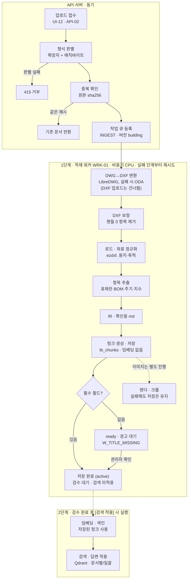

# DWG 도면 업로드·기본 파싱 서비스 설계 및 개발 요구사항 v0.3

> 작성 2026-11-04 · 갱신 2026-11-09 (v0.3) · 원본: Claude Docs 설계 문서에서 내보냄. 이 파일은 Claude Code 전달용 사본이며, 값이 다르면 작업지시서(`CLAUDE_CODE_작업지시서_Phase6_도면1단계.md`)를 따른다.

## 1. 개요

관리자가 DWG를 올리면 **DWG→DXF 변환 → 보정 → ezdxf 파싱 → 표제란·개정이력·BOM·주기·치수 추출 → 렌더·크롭 → 청크 생성·저장**까지 자동으로 처리한다. **1단계는 파싱·저장까지만 하고 검색에는 쓰지 않는다.** 관리자 검수로 추출 품질이 확인되면 2단계에서 저장된 청크를 임베딩·색인해 검색에 적용한다(2026-11-09 결정). 샘플 3종으로 이 경로를 직접 돌려 봤고 변환·로드·렌더 모두 동작했다. 다만 기존 규칙을 그대로 쓰면 실패하는 지점이 4곳 있었다(2장).

| 항목 | 내용 |
| --- | --- |
| 목적 | 1단계: DWG 업로드 시 기본 파싱 결과(IR·청크·이미지)를 저장하고 관리자가 검수한다. 2단계: 검수된 도면을 검색·답변에 쓴다 |
| 1단계 범위 (파싱·저장) | 업로드·검증·변환·보정·파싱(G-1\~G-5, G-9\~G-13)·렌더·크롭·청크 생성·저장(임베딩 없음)·확인용 md·처리 결과 화면·검수 완료 표시 |
| 2단계 범위 (검색 적용) | 저장된 청크 임베딩·Qdrant 색인, \[검색 적용\]·해제(문서별·일괄), 도면 검증 질의 평가 |
| 범위 밖 | 치수↔형상 연결·뷰 의미(VLM, G-14), 추출값 편집 화면, PDF·스캔 도면, 3D 모델 |
| 샘플 | `Taylor_C2_Module.DWG`(조립도), `S2803265.DWG`·`S2803463.DWG`(벨트 가공품) |
| 기준 문서 | DXF 도면처리 기술검토 v0.1, 작업지시서 v3.1 6장(Phase 6), 화면·API ID 목록(MOD-14), DB 구조 변경안 v0.1, UI-12 목업 v0.5 |

**단계를 나눈 이유**: 추출 규칙은 같은 SolidWorks 양식 3장으로만 검증했다. 다른 양식에서 잘못 추출된 값이 바로 색인되면 엑셀 SOP 답변에 섞인다. 파싱 품질(표제란·BOM 정답률)을 검색 품질과 따로 재고, 청크는 1단계에서 미리 저장해 2단계가 재파싱 없이 임베딩·색인만 하게 한다.

**2단계 전환 기준**: ① 정답 표 대비 표제란 필수 3필드 100%·BOM 행 누락 0, ② 다른 양식 도면 2\~3장 추가 검증, ③ 대상 도면 관리자 검수 완료, ④ LibreDWG·ODA 라이선스 검토 완료.

**범위 변경 결정 필요.** 작업지시서 v3.1 6장과 MOD-14는 `.dwg`를 1차에서 `415 UNSUPPORTED_FORMAT`으로 막고 DWG 변환을 2차(R8-1)로 두었다. 이 설계는 DWG 파싱·저장(1단계)을 1차로 당기는 안이다. 1단계는 검색에 쓰지 않아 운영 영향이 업로드·저장에 한정된다. 승인되면 변경로그에 D-25로 올리고 MOD-14 비고를 고친다. 2단계(검색 적용) 시점은 위 전환 기준을 충족한 뒤 따로 정한다.

## 2. 샘플 DWG 3종 분석 결과

세 파일 모두 **SolidWorks에서 내보낸 R2000(AC1015) DWG, cp949(ANSI\_949), mm 단위**이며, 같은 표제란 양식을 쓴다. LibreDWG 0.13.3 `dwg2dxf` + ezdxf 1.4로 작업 환경에서 직접 돌려 확인했다(2026-11-04).

| 항목 | Taylor\_C2\_Module | S2803265 | S2803463 |
| --- | --- | --- | --- |
| 도면 종류 | 조립도(ASSY) | 가공품(벨트) | 가공품(벨트) |
| 표제란 품번 / 품명 | S2802870 / ASSY\_NEOCON C2 MODULE(TAYLOR) | S2803265 / BELT\_HTD 8M | S2803463 / BELT\_ROTOR |
| REVISION / SCALE / DATE | F.5 / 1:12 / 2026-08-31 | A.3 / 1:5 / 2026-07-14 | A.2 / 2:1 / 2026-07-14 |
| DWG 크기 → DXF 크기 | 3.4 MB → 14.9 MB | 129 KB → 458 KB | 158 KB → 569 KB |
| 변환 / ezdxf 로드 / 렌더(150dpi) | 0.35 s / 2.5 s / 24 s | 0.01 s / 0.06 s / 0.8 s | 0.02 s / 0.07 s / 1.3 s |
| 모델공간 엔티티 | 52,404 (LINE 41,939, SPLINE 3,081, HATCH 132) | 1,243 | 1,498 |
| MTEXT / DIMENSION / LEADER | 65 / 3 / 6 | 76 / 1 / 0 | 65 / 10 / 1 |
| 표(SW\_TABLEANNOTATION) | 개정이력 3행 + BOM 8행 | 개정이력(빈 표) | 개정이력(빈 표) |
| 풍선 | 6개(1·2·3·4·6·7), BOM 5·8번 풍선 없음 | 없음 | 없음 |
| 변환 결함 | HATCH 34개 경계 손상(x≈-194,833) | 없음 | 없음 |

**파싱 설계에 반영해야 할 발견 8건**

1. **LibreDWG가 만든 DXF는 ezdxf가 그대로 열지 못한다.** OBJECTS 사전에 이름 없고 핸들 0을 가리키는 항목 4개가 생겨 `readfile`·`recover` 모두 `Invalid handle 0`으로 실패한다. 해당 항목을 지우는 보정 단계를 넣으면 3종 모두 열린다(FR-05).
2. **표제란에 ATTRIB이 없다.** 모두 일반 MTEXT다. 대신 필드 위치를 도면 범위(`$EXTMAX`)로 나눈 정규화 좌표가 3종에서 소수점 4자리까지 같다(예: PART NUMBER 값 x=0.8630, y=0.0487). 양식 템플릿 방식을 첫 순위로 둔다(FR-08).
3. **값은 라벨 아래에 있다.** 기술검토 G-4 ②의 "같은 행 오른쪽 값" 규칙으로는 이 양식에서 값을 못 찾는다. 라벨 인접 규칙에 "아래 칸" 방향을 추가한다.
4. **모델공간 좌표 = 용지 크기 × 축척.** A3(420×297)에 1:5면 범위가 2100×1485, 1:12면 5040×3564, 2:1이면 210×148.5다. 위치 규칙은 모두 정규화 좌표로 쓴다. 레이아웃 2개는 비어 있다.
5. **BOM·개정이력은 `SW_TABLEANNOTATION_n` 블록 안에 있다.** INSERT를 전개해야 문자가 나온다. BOM 헤더는 `NO, REVISION, PART_NAMBER(오타 그대로), PTC_WM_PART_NAME, Q'TY, MATERIAL, MATERIAL_GROUP, PART_SPEC, AFTER_TREATMENT`이고, 헤더·셀이 2\~3줄로 나뉘어 y좌표가 행마다 ±2\~3 흔들린다. 행은 문자 y가 아니라 표 가로선 사이 띠로 묶는다.
6. **개정이력 표는 헤더가 아래, BOM은 헤더가 위**다(G-5의 방향 자동 판별 필요). Taylor 개정: F(2026-05-11 Filter Assy 억제 해제) · D(2026-01-07) · C(2025-12-15).
7. **파일명 ≠ 도번.** `Taylor_C2_Module.DWG`의 품번은 S2802870이다. doc\_key는 표제란 PART NUMBER를 쓰고 파일명은 표제란 미검출 때만 쓴다.
8. **렌더 함정 2건.** ① 손상 HATCH 때문에 전체 범위가 40배 넓어져 그림이 점으로 나오고, 일부는 B-spline knot 오류로 렌더러가 멈춘다. ② 글꼴 GOTHIC.TTF·MALGUN.TTF가 서버에 없으면 한글이 □로 나온다. 렌더 범위를 `$EXTMIN/$EXTMAX`로 고정하고, 범위 5% 밖 엔티티·경계 오류 HATCH는 건너뛰며 경고를 남기고, 한글 글꼴을 대체 지정하자 정상 렌더됐다.

그 밖의 특성: 형상은 거의 모두 레이어 `0`이라 레이어로는 분류할 수 없다. 치수는 `<>` + 측정값이고 접두·접미(`4-Ø 3.8 THRU`, `(2.62)` 참고치수)는 `_D_n` 블록 문자에 있다. 주기는 `Notes 1. 일반 공차 … KS B ISO 2768-m/K` 형식이고, 벨트 도면 왼쪽 위에 규격 메모(`<BELT 규격 : HTD 8M, 폭 50mm>`)가 있다. 모든 도면에 일반공차표(정밀급·보통급·판금)와 `Confidential` 문구가 있고, `PTC_WM_PART_NAME` 헤더로 보아 Windchill 연동 양식으로 추정한다. REVISION `F.5`는 "개정 F, 반복 5"로 보고 나눠 저장한다(확인 필요, 8장 Q-3).

## 3. 서비스 흐름

API는 판별·중복 확인까지만 동기로 처리하고, 변환부터 청크 저장까지는 적재 워커(WRK-01)가 맡는다. **1단계는 저장 완료에서 멈추고**, 임베딩·색인은 관리자가 검수한 뒤 \[검색 적용\]을 누를 때 2단계로 실행한다. 렌더는 저장을 막지 않도록 뒤에서 따로 돈다.



표제란 필수 필드(품번·품명·개정)가 모두 나오면 버전을 저장 완료(`active`)로 확정하고, 빠지면 `ready`로 두었다가 관리자가 값을 입력한 뒤 확정한다. 버전이 `active`여도 문서의 `search_enabled`가 false이면 검색에 쓰지 않는다. 기존 `ready`(경고 대기)와 의미가 겹치지 않도록 검색 적용 여부는 버전 상태가 아닌 문서 플래그로 둔다.

| 대상 | 상태 전이 | 비고 |
| --- | --- | --- |
| 작업(`tb_ingest_jobs.status`) | queued → running → completed / failed / cancelled | 단계는 `current_step`(8.1) |
| 버전(`tb_document_versions.status`) | building → active, building → ready → active, building → failed | 같은 품번 이전 버전은 active → retired |
| 검수(`tb_document_events` review) | 미검수 → 검수 완료 | 1단계. 검수 완료 문서만 검색 적용 가능 |
| 검색 적용(`tb_documents.search_enabled`) | false → true(색인 완료 시) → false(해제) | 2단계. 1단계에서는 항상 false |
| 이미지 | 없음 → 생성 / 실패(경고) | 렌더 실패가 버전 상태를 바꾸지 않음 |

## 4. 기본 파싱 모듈 아키텍처

모듈은 `ingest/drawing/`(MOD-14) 아래에 두고, **변환기는 어댑터로 감싸 교체 가능하게, 읽기는 ezdxf 하나로** 통일한다. 기술검토 PoC의 `extract.py`·`textcodes.py` 규칙은 그대로 옮기고 `dxfreader.load()`만 ezdxf로 바꾼다.

| 컴포넌트(파일) | 역할 | 입력 → 출력 | 비고 |
| --- | --- | --- | --- |
| `detect.py` | 형식·버전 판별 | 바이트 → `{kind: dwg\|dxf_ascii\|dxf_binary, acadver}` | 매직 `AC10xx`. MOD-01 파일 라우터가 호출 |
| `convert/base.py` | 변환기 인터페이스 | `convert(dwg_path, out_dir, timeout) → ConvertResult` | 구현체 2개, 설정으로 선택 |
| `convert/libredwg.py` | LibreDWG `dwg2dxf` 호출(별도 프로세스) | DWG → DXF + 로그 | 샘플 3종 검증. GPLv3 법무 검토 |
| `convert/oda.py` | ODA File Converter 호출 | DWG → DXF | 대체·교차확인용. 약관 검토 |
| `sanitize.py` | 변환 결과 보정 | DXF → 보정 DXF + 보정 내역 | 핸들 0 사전 항목 제거 등(FR-05) |
| `reader.py` | ezdxf 로드 | DXF → `Drawing` | `readfile` 실패 시 `recover` |
| `normalize.py` | 도면 좌표계 | `$EXTMIN/$EXTMAX`, 축척 → 정규화 변환 | 용지 크기 추정(A3 등) |
| `textcodes.py` | 문자 정규화 | MTEXT·`%%`·`\U+`·`\M+` → 평문 | PoC 재사용 |
| `extract/` | 항목 추출 | 표제란(`title.py`)·표(`tables.py`)·주기(`notes.py`)·치수(`dims.py`)·풍선(`balloons.py`)·기타 문자 | 표제란은 템플릿 → ATTRIB → 라벨 인접 순 |
| `templates/*.yaml` | 양식 템플릿·키워드 사전 | 필드별 정규화 영역, BOM 헤더 별칭 | 기존 `drawing_keywords.yaml` 확장 |
| `render.py` | PNG 렌더·크롭 | `Drawing` → 전체·표제란·BOM·개정·주기 PNG | ezdxf `addons.drawing` + matplotlib |
| `ir.py` / `chunks.py` | IR·청크 생성 | 추출 결과 → 공통 IR(MOD-06) → 청크 | 기술검토 6장 content\_type |
| `export_md.py` | 확인용 md | IR → md | MOD-12 F-1 규칙 |
| `pipeline.py` | 단계 실행·상태 보고 | 작업 → 단계별 결과·경고·진행률 | WRK-01이 호출 |

**검색 적용 제어**: `pipeline.py`는 청크를 `tb_chunks`에 저장한 뒤, 설정 `DRAWING_INDEX_ENABLED`(기본 false)와 문서의 `search_enabled`를 보고 임베딩·색인 단계를 건너뛴다. 2단계에서는 같은 파이프라인의 `embed`·`index` 단계만 실행하므로 다시 파싱하지 않는다. 색인 전 검색 성능을 보려면 운영 컬렉션이 아닌 테스트 컬렉션에만 색인해 질의해 볼 수 있다.

**기술 스택**: Python 3.11+, ezdxf 1.4.x(MIT), LibreDWG 0.13.3 CLI(GPLv3, 소스 빌드), matplotlib 3.x, 한글 글꼴(Noto Sans CJK 또는 나눔고딕). 작업 환경에서 PyPI가 막혀 ezdxf는 GitHub 소스로, LibreDWG는 릴리스 tarball로 설치했다. 운영 서버도 같은 방식(내부 미러 또는 이미지 빌드 시 포함)을 정해야 한다.

**변환기 분리 이유**: LibreDWG는 라이선스(GPLv3) 때문에 라이브러리로 링크하지 않고 별도 프로세스로만 호출한다. 또 최신 DWG(R2018 이상) 호환성이 버전마다 달라, 실패하면 ODA로 다시 시도할 수 있어야 한다. 설정은 `DWG_CONVERTER=libredwg|oda`, `DWG_CONVERTER_FALLBACK=oda|none`, `DWG_CONVERT_TIMEOUT_SEC=120`이다.

## 5. 기능 요구사항 (FR)

**단계** 1=파싱·저장, 2=검색 적용. **우선** M=해당 단계 필수, S=가능하면 해당 단계, C=그 뒤. ‘근거’는 2장 발견 번호 또는 기술검토 규칙 ID다.

| ID | 요구사항 | 수용 기준(샘플 3종) | 단계 | 우선 | 근거 |
| --- | --- | --- | --- | --- | --- |
| FR-01 | 업로드: UI-12에서 `.dwg`·`.dxf`를 받고 문서 유형 `drawing`으로 접수. 파일당 최대 100 MB(설정) | 3개 동시 업로드 시 3개 작업 생성, 중복 없음 | 1 | M | API-02 |
| FR-02 | 형식 판별: 확장자 + 매직바이트. DWG는 `AC1012`\~`AC1032` 허용, 그 밖은 `415` | 3종 모두 `AC1015` 판별. 확장자만 `.dwg`인 텍스트 파일은 거부 | 1 | M | G-1 |
| FR-03 | 중복 확인: 원본 sha256이 같은 활성 버전이 있으면 새 작업을 만들지 않고 기존 문서 반환 | 같은 파일 재업로드 시 `duplicate` 응답 | 1 | M | DB 4.1 |
| FR-04 | DWG→DXF 변환: 별도 프로세스·타임아웃(기본 120 s)·메모리 제한, 종료 코드·경고 로그 저장. 실패 시 대체 변환기 1회 | 3종 모두 변환 성공, Taylor 1 s 안 | 1 | M | 발견 1 |
| FR-05 | DXF 보정: 핸들 0을 가리키는 사전 항목 제거 등 보정 규칙을 적용하고 보정 건수를 경고로 남김. 원본 DXF도 보관 | 3종 모두 ezdxf `readfile` 성공(각 4건 보정) | 1 | M | 발견 1 |
| FR-06 | 로드·인코딩: ezdxf 로드, `$DWGCODEPAGE`로 한글 해석, 한글 깨짐률 점검 | 한글 문자 27·42·32건 모두 정상 | 1 | M | G-1 |
| FR-07 | 좌표 정규화: 도면 범위와 축척으로 용지 크기·정규화 좌표 계산, 모델공간이 비면 레이아웃 사용 | 3종 모두 A3 판별 | 1 | M | 발견 4 |
| FR-08 | 표제란: ① 템플릿(정규화 영역) → ② ATTRIB → ③ 라벨 인접(오른쪽·아래). 필드: 품번·품명·개정·날짜·축척·재질·재질그룹·후처리·PART SPEC·작성·검토·승인·단위·시트 | 필수 3필드(품번·품명·개정) 3종 100% | 1 | M | 발견 2·3, G-4 |
| FR-09 | 블록 전개: INSERT 삽입점·배율·회전 적용, `SW_TABLEANNOTATION`·`SW_NOTE` 안 문자 추출, `_D*`·`*D` 치수 블록은 치수에만 사용 | Taylor BOM·개정 표 문자 전부 추출 | 1 | M | 발견 5, G-3 |
| FR-10 | 표 복원(BOM·개정이력): 헤더 별칭 사전 매칭, 표 선으로 행·열 경계, 여러 줄 셀 합치기, 헤더 위/아래 자동 판별 | Taylor BOM 8행·9열 전 셀 정답, 개정 3행 정답, 빈 표는 0행 | 1 | M | 발견 5·6, G-5 |
| FR-11 | 주기: `Notes`/`주기` 아래 번호 항목 분리, 일반공차 규격(KS B ISO 2768-m/K) 추출, 규격 메모(`<… 규격 : …>`) 수집 | S2803265 주기 6항목·규격 메모 5줄 | 1 | M | G-9 |
| FR-12 | 치수: 표시 문자 재구성(`<>`→측정값, 블록 문자의 접두 `4-Ø` 결합), 참고치수 구분, 공차 분류 | S2803463 치수 10개 중 `4-Ø3.8 THRU`, `(2.62)` 참고 정답 | 1 | M | G-6 |
| FR-13 | 공차 구성 요약: 지정공차 수·기하공차 수·`general_tolerance_only` | 샘플 3종 모두 `true` | 1 | M | G-11 |
| FR-14 | 풍선↔BOM: `SW_NOTE` 블록(원 + 번호 1개)을 풍선으로, 가장 가까운 LEADER 끝점을 지시 위치로, BOM 품번 매칭, 양방향 미매칭 경고 | Taylor 풍선 6개 연결, BOM 5·8번 ‘풍선 없음’ 경고 2건. 개정 구름 표시(`D`)는 풍선에서 제외 | 1 | S | G-10 |
| FR-15 | 도면 간 연결: BOM 품번 = 다른 도면 품번이면 `child_drawing`/`used_in` 저장, 나중에 올라온 도면도 역방향 갱신 | S2802871(ROTOR) 도면이 올라오면 Taylor와 연결 | 1 | S | G-12 |
| FR-16 | 렌더: 범위를 헤더 범위로 고정, 범위 5% 밖·경계 오류 엔티티 건너뛰기(경고), 한글 대체 글꼴 매핑, 전체 PNG(긴 변 4,000 px) | Taylor 34개 제외 후 정상 렌더, 한글 □ 0 | 1 | M | 발견 8, G-13 |
| FR-17 | 크롭: 표제란·BOM·개정·주기 영역 PNG, sha256 키로 `tb_image_assets` 저장 | 도면당 크롭 2\~4개 | 1 | M | G-13 |
| FR-18 | 청크 생성·저장: `drawing_overview`·`drawing_revision`·`drawing_bom`·`drawing_bom_item`·`drawing_notes`·`drawing_dimensions`·`drawing_misc_text`, 접두 `[도면 {품번} {품명} Rev.{개정} > 섹션]`. `tb_chunks`에 저장하고 **임베딩·색인은 하지 않음** | Taylor 청크 13개 저장, Qdrant 포인트 0 | 1 | M | 기술검토 6장 |
| FR-19 | 일반공차표·고정 문구 제외: 양식에 항상 있는 일반공차표·`Confidential` 문구는 템플릿에서 제외, `Confidential`은 보안 등급 후보 메타로 저장 | 기타 문자 청크에 공차표 값 0건 | 1 | M | 2장 |
| FR-20 | 버전: doc\_key = 표제란 품번(없으면 파일명), 같은 품번 재업로드는 교체 후보로 제안(교체 대상은 관리자가 지정, D-01), 개정 역행 시 경고 | Taylor doc\_key = S2802870 | 1 | M | 발견 7 |
| FR-21 | 확인용 md: `{MD_SAVE_DIR}/drawing/{doc_key}/{job_id}/` 에 요약·표·청크·경고 md, 최근 5회 보관 | 3종 md 생성 | 1 | M | MOD-12 |
| FR-22 | 처리 결과 조회: UI-12 \[처리 결과\]에 표제란·부품표·개정이력·주기·치수·경고·처리 정보와 원본 영역 크롭 표시 | 3종 결과 화면 표시 | 1 | M | API-09 |
| FR-23 | 검수 완료 표시: 관리자가 처리 결과를 확인하고 \[검수 완료\]를 누르면 검수자·시각을 `tb_document_events`(review)에 기록. 목록에 검수 상태 표시 | 3종 검수 완료 후 목록·이력 반영 | 1 | M | 2단계 전환 기준 |
| FR-24 | 임베딩·색인: 저장된 청크를 임베딩해 주제 컬렉션에 색인, payload `doc_type=drawing`·`drawing_no`·`rev`·`part_no`, 재파싱 없음 | Taylor 13개 포인트 생성, `embedded_at` 기록 | 2 | M | D-21 |
| FR-25 | 검색 적용·해제: 검수 완료 문서만 문서별·일괄 \[검색 적용\], 해제 시 포인트 삭제·`search_enabled=false` | 미검수 문서는 버튼 비활성, 해제 후 검색 0건 | 2 | M | — |
| FR-26 | 도면 검증 질의: 8.2의 검색 질의 6건 Top-5, 엑셀 질의 정답률 하락 없음 | 6건 모두 Top-5 | 2 | M | TST-02 |
| FR-27 | 치수↔형상 연결·뷰 캐션(VLM) | — | — | C | G-14 |

**v0.3 추가 요구사항** — 2단계 전환을 쉽게 하려고 1단계에 미리 할 일(FR-28\~31)과, 저장 구조 밖에서 2단계에 손봐야 할 일(FR-32\~34).

| ID | 요구사항 | 수용 기준(샘플 3종) | 단계 | 우선 | 근거 |
| --- | --- | --- | --- | --- | --- |
| FR-28 | 청크 재생성: 저장된 IR에서 청크만 다시 만들기(`rechunk`, DWG 변환 없음). 청크에 생성 규칙 버전 `chunker_version` 기록 | IR만으로 Taylor 청크 13개 재생성, 변환기 호출 0 | 1 | M | 6.1 |
| FR-29 | 출처 라벨: 청크마다 답변 출처에 쓸 라벨(예: `S2802870 Rev F.5 · 부품표 6번`)과 연결 이미지 역할을 `meta_json`에 저장 | 청크 13개 모두 라벨·이미지 연결 보유 | 1 | M | FR-33 준비 |
| FR-30 | 토큰 수: 청크별 `token_count` 기록, 설정 상한(`DRAWING_CHUNK_MAX_TOKENS`) 초과 시 BOM 청크를 행 단위로 나눠 저장 | 상한 초과 청크 0 | 1 | M | 임베딩 한도 |
| FR-31 | 테스트 컬렉션 색인(개발 환경 전용): 운영 컬렉션이 아닌 별도 테스트 컬렉션에만 색인해 질의해 볼 수 있는 명령(CLI) | 운영 컬렉션 포인트 0, 테스트 컬렉션에서 검색 질의 실행 가능 | 1 | S | Q-9 |
| FR-32 | 검색 필터: 검색 엔진(MOD-08)에 `search_enabled` 조건 추가, Qdrant payload 인덱스 `doc_type`·`drawing_no`·`part_no` 생성 | 해제 직후 검색 0건, 품번 질의 정확 일치 | 2 | M | D-21 |
| FR-33 | 도면 출처 표시: 답변 출처(MOD-09)와 화면(UI-03 답변, UI-05 참고 문서)에 도면용 출처 카드(품번·Rev·영역 + 크롭 이미지). 현재는 엑셀 기준(시트!셀) | 검증 질의 6건의 출처 카드가 도면 형식으로 표시 | 2 | M | FR-29 |
| FR-34 | 재처리 교체: 검색 적용 중인 도면을 다시 처리하면 새 결과를 검수한 뒤 색인을 교체(그 전까지 기존 포인트 유지) | 재처리 중 검색 결과 변화 없음 | 2 | M | 엑셀 A-4 버전 스왑 |

## 6. 출력 데이터 스키마 및 DB 매핑

파싱 결과는 **도면 IR JSON 1개**(`ir_path`에 저장)로 내고, 청크·이미지는 DB 변경안 v0.1의 기존·신규 테이블에 그대로 넣는다. 아래는 Taylor 샘플을 기준으로 한 IR 예시(일부)다.

```json
{
  "schema": "drawing_ir/1.0",
  "source": {"filename": "Taylor_C2_Module.DWG", "sha256": "…", "format": "dwg", "acadver": "AC1015",
             "codepage": "ANSI_949", "producer": "solidworks",
             "converter": {"name": "libredwg", "version": "0.13.3", "elapsed_ms": 352, "sanitize_fixes": 4}},
  "sheet": {"size": "A3", "paper_mm": [420, 297], "scale": "1:12", "units": "mm",
            "extents": [[0, 0], [5040, 3564]], "space": "model"},
  "title_block": {"method": "template:yest_a3_v1",
    "fields": {"part_no": "S2802870", "part_name": "ASSY_NEOCON C2 MODULE(TAYLOR)",
               "revision": "F.5", "rev_major": "F", "rev_iter": 5, "date": "2026-08-31",
               "scale": "1:12", "material": "NONE", "material_group": "ASSY",
               "after_treatment": "NONE", "part_spec": "ASSY", "drawn": "작성자A"},
    "bbox_norm": [0.70, 0.02, 0.99, 0.15]},
  "tables": [
    {"kind": "revision", "header_pos": "bottom", "columns": ["no", "description", "date", "drawn", "checked"],
     "rows": [["F", "Filter Assy 억제 해제", "2026-05-11", "작성자B", "작성자B"]]},
    {"kind": "bom", "header_pos": "top",
     "columns": ["item_no", "revision", "part_no", "part_name", "qty", "material", "material_group", "part_spec", "after_treatment"],
     "rows": [["6", "C", "MEC15710", "SENSOR_HUMIDITY&TEMPERATURE", "1", "재질 <지정안함>", "SIEMENS", "QFM2171", "…"]]}],
  "balloons": [{"no": "6", "pos_norm": [0.823, 0.257], "target_norm": [0.796, 0.447], "bom_item": "6"}],
  "notes": [], "dimensions": [{"text": "873.5", "measured": 873.5, "tol_class": "general"}],
  "tolerance_summary": {"specified": 0, "gdt": 0, "general_tolerance_only": true},
  "links": [{"type": "child_drawing", "part_no": "S2802871", "bom_item": "1"}],
  "images": [{"role": "drawing_full", "sha256": "…"}, {"role": "bom", "sha256": "…"}],
  "warnings": [{"code": "W_RENDER_SKIPPED", "count": 34, "detail": "HATCH 범위 밖·경계 오류"},
               {"code": "W_BOM_NO_BALLOON", "items": ["5", "8"]}]
}
```

| IR 항목 | 저장 위치 | 컬럼·값 | 단계 |
| --- | --- | --- | --- |
| 문서 대표 | `tb_documents` | `doc_key`=품번, `file_format`='dwg', `parser_type`='drawing', `file_sha256`, **`search_enabled`=false(신규)** | 1 |
| 버전 | `tb_document_versions` | `revision_label`=표제란 REVISION, `ir_path`, `warnings_json`, `change_summary_json`(변환기·보정 건수·도면 요약) | 1 |
| 작업 단계·진행률 | `tb_ingest_jobs` | `current_step`에 8.1 단계 코드, `progress_pct` | 1 |
| 검수 | `tb_document_events` | `event_type`='review', 검수자·시각·버전 | 1 |
| 청크 | `tb_chunks` | `chunk_type`='drawing', `content_type`=FR-18 7종, `heading_path`, `location_json`={bbox\_norm}, `meta_json`={part\_no, rev, scale, item\_no…}. 1단계는 `point_id`만 미리 계산하고 `embedding_model`·`embedded_at`은 NULL | 1 저장 / 2 임베딩 |
| Qdrant payload | 주제 컬렉션(D-21) | `doc_type`='drawing', `drawing_no`, `rev`, `part_no`, `content_type` | 2 |
| 렌더·크롭 | `tb_image_assets` + `tb_spreadsheet_resources` | `role_cd`='drawing'(전체)·'drawing\_crop'(영역), `location_json`={region, bbox\_norm} | 1 |
| 청크↔이미지 | `tb_chunk_resources` | overview→전체·표제란, bom→BOM 크롭, revision→개정 크롭 | 1 |
| 도면 간 연결 | **신규 제안** `tb_drawing_links` | (parent\_part\_no, child\_part\_no, bom\_item\_no, qty, parent\_document\_id, child\_document\_id NULL 허용) | 1 |

DB 변경안 36개 테이블에 없는 신규 항목은 2개다. ① `tb_documents.search_enabled`(boolean, NOT NULL, 기본 false): 도면은 1단계에서 false로 두고 2단계 \[검색 적용\] 시 true가 된다. 기존 문서(엑셀·PDF)는 이관 시 true로 채워 동작이 바뀌지 않는다. 검색 엔진(MOD-08) 필터에도 같은 조건을 더해 색인 해제 직후에도 검색되지 않게 한다. ② `tb_drawing_links`: 하위 도면이 나중에 올라와도 품번으로 연결해야 해서 `meta_json`만으로는 조회가 어렵다. 승인 시 D-26 + Alembic `0007_drawing`(두 항목 함께)로 추가한다. 현행 `tb_documents`의 문서 유형 컬럼에 `drawing` 값이 허용되는지는 확인이 필요하다.

### 6.1 저장 구조

1단계는 **파일 저장소와 PostgreSQL 두 곳에만** 저장하고 Qdrant에는 쓰지 않는다. 무거운 파일은 저장소(INF-01), 찾고 연결하는 정보와 청크 본문은 RDB에 둔다.

| 저장 위치 | 항목 | 경로·테이블(안) | 보관 |
| --- | --- | --- | --- |
| 파일 저장소 | 원본 DWG/DXF | `{원본 저장소}/{document_id}/v{n}/{파일명}` | 버전 삭제 전까지 |
| 파일 저장소 | 변환 DXF(보정 전·후) | `…/v{n}/derived/converted.dxf`, `sanitized.dxf` | 활성 버전만. 이전 버전은 WRK-06이 삭제(Taylor 3.4 MB → 14.9 MB로 커짐) |
| 파일 저장소 | 도면 IR | `…/v{n}/derived/drawing_ir.json` (`drawing_ir/1.0`) | 버전 삭제 전까지. 청크 재생성(FR-28)의 입력 |
| 파일 저장소 | 렌더·크롭 PNG | `{RESOURCE_STORAGE_ROOT}` 아래 해시 경로, 원본·미리보기·썸네일 3종 | 기존 이미지 정책(GC 7일 유예) |
| 파일 저장소 | 확인용 md | `{MD_SAVE_DIR}/drawing/{doc_key}/{job_id}/` | 최근 5회 |
| PostgreSQL | 문서·버전·작업·이력 | `tb_documents`(search\_enabled), `tb_document_versions`(ir\_path·warnings\_json), `tb_ingest_jobs`, `tb_document_events` | — |
| PostgreSQL | 청크 | `tb_chunks`(본문·meta·point\_id·token\_count·chunker\_version, 임베딩 칼럼 NULL) | — |
| PostgreSQL | 이미지·연결 | `tb_image_assets`, `tb_spreadsheet_resources`, `tb_chunk_resources`, `tb_drawing_links` | — |
| Qdrant | 없음(1단계) | 2단계 \[검색 적용\] 시 주제 컬렉션에 색인 | — |

**2단계 호환성**: 2단계는 `tb_chunks`를 그대로 임베딩해 Qdrant에 넣고 `embedded_at`·`search_enabled`만 바꾼다. 파일 저장소는 바뀌지 않는다. 청크 문구·크기를 조정해야 하면 DWG 변환 없이 IR에서 청크만 다시 만든다(FR-28). 임베딩을 미리 하지 않으므로 그 사이 임베딩 모델이 바뀌어도 다시 할 일이 없다.

## 7. 비기능 요구사항 및 오류 코드

수치는 샘플 실측값(2장)에 여유를 둔 목표다. 가장 큰 비용은 렌더(Taylor 24 s)이므로, 렌더는 텍스트 청크 적재를 기다리게 하지 않는다.

| ID | 항목 | 요구사항 |
| --- | --- | --- |
| NFR-01 | 처리 시간 | 5만 엔티티급 도면: 변환+로드+추출 10 s 이하, 렌더 포함 전체 60 s 이하. 소형 도면 전체 5 s 이하 |
| NFR-02 | 자원 | 변환·렌더는 CPU 워커에서 실행(GPU 불필요), 작업당 메모리 상한 2 GB(설정), 초과 시 작업 실패 처리 |
| NFR-03 | 격리 | 변환기는 별도 프로세스, 작업별 임시 폴더, 네트워크 없이 실행. 업로드 파일은 신뢰하지 않는 입력으로 본다 |
| NFR-04 | 재시도 | 실패한 단계부터 재시도(WRK-01). 변환 결과 DXF는 작업 사이 보관해 재시도 시 다시 변환하지 않음 |
| NFR-05 | 부분 성공 | 렌더·크롭·풍선 실패는 경고만 남기고 텍스트 청크는 적재. 표제란 필수 필드 미검출은 `ready`(경고 대기)로 두고 관리자 확인 후 적용 |
| NFR-06 | 재현성 | 같은 입력·같은 변환기 버전이면 같은 IR(타임스탬프 제외). 변환기·ezdxf·템플릿 버전을 IR에 기록 |
| NFR-07 | 보안·권한 | 원본 DWG·변환 DXF·렌더 이미지는 문서 권한과 같은 접근 제어(API-06). `Confidential` 도면은 보안 등급 지정을 관리자에게 제안 |
| NFR-08 | 설치·라이선스 | 변환기는 컨테이너 이미지에 포함, 버전 고정. LibreDWG(GPLv3)·ODA 약관 법무 확인 전에는 운영 배포 금지 |
| NFR-09 | 관측 | 단계별 소요 시간·엔티티 수·보정 건수·건너뛴 엔티티 수를 작업 결과에 기록, 관리 현황(API-14)에 집계 |
| NFR-10 | 설정 분리 | 템플릿·키워드·헤더 별칭·글꼴 매핑은 YAML. 코드 변경 없이 양식 추가 가능 |

**오류 코드** (작업 실패 = E, 경고 = W)

| 코드 | 단계 | 의미 | 처리 |
| --- | --- | --- | --- |
| `E_UNSUPPORTED_FORMAT` | 판별 | 확장자·매직 불일치, 허용 버전 밖 | 415, 작업 미생성 |
| `E_FILE_TOO_LARGE` | 접수 | 크기 상한 초과 | 413 |
| `E_CONVERT_FAILED` | 변환 | 변환기 비정상 종료(대체 변환기까지 실패) | 실패, 재시도 가능 |
| `E_CONVERT_TIMEOUT` | 변환 | 제한 시간 초과 | 실패, 프로세스 강제 종료 |
| `E_DXF_LOAD` | 로드 | 보정·`recover` 후에도 로드 실패 | 실패, 변환 DXF 보관 |
| `E_EMPTY_DRAWING` | 로드 | 모델·레이아웃 모두 엔티티 0 | 실패 |
| `W_SANITIZED` | 보정 | 보정 규칙 적용(건수) | 정보성 |
| `W_CONVERTER_WARN` | 변환 | 변환기 경고(예: Object handle not found) | 기록 |
| `W_ENCODING` | 로드 | 한글 깨짐률 1% 초과, 폴백 인코딩 사용 | 관리자 확인 |
| `W_TITLE_MISSING` | 추출 | 필수 필드(품번·품명·개정) 미검출 | `ready` 대기, 파일명을 doc\_key로 |
| `W_TEMPLATE_MISMATCH` | 추출 | 템플릿 라벨 일치 50% 미만 → 라벨 인접 방식 사용 | 기록 |
| `W_TABLE_PARSE` | 추출 | 헤더는 있으나 행·열 복원 실패 | 표 전체를 텍스트 청크로 |
| `W_BOM_NO_BALLOON` / `W_BALLOON_NO_BOM` | 추출 | 풍선↔BOM 미매칭 | 기록 |
| `W_XREF_MISSING` | 로드 | 외부 참조 파일 없음 | 함께 업로드 안내 |
| `W_RENDER_SKIPPED` | 렌더 | 범위 밖·기하 오류 엔티티 제외(건수) | 기록 |
| `W_RENDER_FAILED` | 렌더 | 렌더 전체 실패 | 이미지 없이 적재 |
| `W_FONT_FALLBACK` | 렌더 | 지정 글꼴 없음, 대체 글꼴 사용 | 기록 |

**경고와 정보 구분**: `W_` 코드는 수준(level)을 함께 저장한다. `warn`은 결과가 틀렸거나 빠졌을 수 있어 확인이 필요한 항목(`W_BOM_NO_BALLOON`, `W_RENDER_SKIPPED`, `W_TABLE_PARSE`, `W_ENCODING` 등)이고, `info`는 자동 조치해 결과에 문제가 없는 항목(`W_SANITIZED`, `W_FONT_FALLBACK`, `W_CONVERTER_WARN`)이다. 문서 목록의 "경고 N"은 `warn`만 세고, 처리 결과 탭은 "경고·정보 2+2"처럼 나눠 표시한다. `W_TITLE_MISSING`은 경고이면서 버전을 `ready`로 두는 유일한 코드다.

## 8. API·테스트·작업 분해·미결사항

### 8.1 API (기존 ID 확장, 신규 ID 없음)

| API | 엔드포인트(안) | 도면 처리에서 바뀌는 점 | 단계 |
| --- | --- | --- | --- |
| API-02 업로드 | `POST /api/admin/documents/uploads` | `document_type=drawing`, `parser=drawing` 허용. `.dwg`·`.dxf` 접수(기존 `415` 처리 해제) | 1 |
| API-03 상태 | `GET /api/admin/jobs?status=`, `POST /api/admin/jobs/{id}/retry` | `current_step` 1단계: `detect`→`convert`→`sanitize`→`load`→`extract`→`chunk_store`→`render`→`done`. 2단계 작업: `embed`→`index`→`done` | 1·2 |
| API-09 처리 결과 | `GET /api/admin/documents/{id}/versions/{v}/result` | 도면이면 표제란 필드·표·풍선 연결·경고·이미지 ID·청크 목록·검수 상태 반환 | 1 |
| API-09 검수 | `POST /api/admin/documents/{id}/versions/{v}/review` | 검수 완료 기록(취소는 `DELETE`). ready 버전은 누락 필드 값 `{fields}`을 함께 받아 확정 | 1 |
| API-06 이미지 | `GET /api/spreadsheet-resources/{id}?size=` | 도면 전체·크롭 이미지도 같은 경로(관리 화면용) | 1 |
| API-04 버전 | `POST /api/admin/documents/{id}/versions` | 표제란 품번이 같은 기존 문서를 교체 대상 후보로 제시 | 1 |
| API-04 검색 적용 | `POST /api/admin/documents/{id}/search-activation` `{enabled}`, 일괄 `POST /api/admin/documents/search-activation` `{document_ids}` | 검수 완료 문서만. true면 `embed`·`index` 작업 등록, false면 포인트 삭제 | 2 |

### 8.2 테스트·수용 기준

1. **정답 표(골든 파일, 1단계)**: 샘플 3종의 표제란 14필드, Taylor BOM 8행×9열, 개정 3행, 풍선 6개, S2803463 치수 10개, S2803265 주기 6항목을 `tests/golden/*.json`으로 만들고, 관리자가 원본 도면과 대조해 확정한다.
2. **1단계 통과 기준**: 표제란 필수 3필드 100%, 전체 필드 95% 이상, BOM 행 누락 0·셀 정답 98% 이상, 한글 깨짐 0, 렌더 이미지 3종 정상(사람 확인), `tb_chunks` 저장 후 Qdrant 포인트 0(검색 미적용 확인).
3. **단위 테스트(1단계)**: 매직 판별, 보정 규칙, 변환 타임아웃·대체 변환기, 템플릿 매칭, 여러 줄 셀 합치기, 헤더 방향 판별, 치수 접두 결합, 일반공차표 제외, 범위 밖 엔티티 제외, `DRAWING_INDEX_ENABLED=false`일 때 임베딩 호출 0. 기존 PoC 테스트 17개는 그대로 통과.
4. **실패 케이스(1단계)**: 확장자만 바꾼 파일, 잘린 DWG(앞 50%만), 0바이트, R2018 DWG, 변환기 강제 종료 — 각각 7장 오류 코드가 나와야 한다.
5. **검색 질의(2단계, Top-5 안)**:
   - "NEOCON C2 모듈 조립도 부품 목록" → Taylor `drawing_bom` + BOM 크롭
   - "C2 모듈에 들어가는 온습도 센서 모델은?" → BOM 6번 QFM2171(SIEMENS, MEC15710)
   - "Taylor 모듈 F 개정 내용" → `drawing_revision`(Filter Assy 억제 해제, 2026-05-11)
   - "S2803463 벨트 규격과 재질" → HTD 8M 폭 50mm, 폴리 우레탄(흰색)
   - "BELT\_HTD 8M 일반공차 규격" → KS B ISO 2768-m / K
   - "BELT\_ROTOR 구멍 사양" → 4-Ø3.8 THRU
6. **회귀(2단계)**: 도면 색인 전후로 기존 엑셀 검증 질의 정답률이 떨어지지 않아야 한다. 먼저 테스트 컬렉션에서 확인한다.

### 8.3 작업 분해 (추정, 1인 기준)

| 단계 | 순서 | 작업 | 추정 | 선행 조건 |
| --- | --- | --- | --- | --- |
| 1 | 1 | 변환기 어댑터·보정·로드(FR-02\~07), 컨테이너 빌드에 LibreDWG·ezdxf·한글 글꼴 추가 | 2일 | Q-1 라이선스 검토 착수 |
| 1 | 2 | 표제란 템플릿·블록 전개·표 복원(FR-08\~10) | 3일 | 1 |
| 1 | 3 | 주기·치수·공차 요약·고정 문구 제외(FR-11\~13, 19) | 1일 | 2 |
| 1 | 4 | 풍선·도면 간 연결(FR-14\~15, S) | 1일 | 2 |
| 1 | 5 | 렌더·크롭(FR-16\~17) | 1.5일 | 1 |
| 1 | 6 | IR·청크 저장(출처 라벨·토큰 수·재생성 포함)·md·파이프라인 연동, API-02/03/09 확장, 검수 표시, `search_enabled` 마이그레이션(FR-01, 18, 20\~23, 28\~30) | 2.5일 | 2·5, WRK-01 |
| 1 | 7 | 골든 정답 표·단위·실패 케이스 테스트, 테스트 컬렉션 CLI(FR-31, S) | 1.5일 | 관리자 정답 확인 |
| 2 | 8 | 임베딩·색인, \[검색 적용\]·해제 API·화면, 검색 필터·payload 인덱스(FR-24\~25, 32) | 1.5일 | 2단계 전환 기준 충족 |
| 2 | 9 | 도면 출처 표시(MOD-09, UI-03·05), 재처리 교체(FR-33\~34) | 1.5\~2일 | 8 |
| 2 | 10 | 도면 검증 질의·엑셀 회귀 확인(FR-26) | 1\~1.5일 | 8·9 |

1단계 약 12.5일(S 항목인 풍선·도면 연결·테스트 컬렉션 CLI를 뒤로 미루면 약 11일), 2단계 약 4\~5일이다. v0.2 대비 1단계에 출처 라벨·토큰 수·청크 재생성(반나절)이, 2단계에 답변 출처 화면·재처리 교체가 더해졌다.

### 8.4 미결사항

| # | 질문 | 제안 |
| --- | --- | --- |
| Q-1 | LibreDWG(GPLv3)·ODA File Converter 중 운영에 무엇을 쓸지, 라이선스·약관 검토 결과 | 별도 프로세스 호출로 LibreDWG 기본, ODA는 약관 확인 후 대체 경로로 |
| Q-2 | DWG 파싱·저장(1단계)을 1차로 당기는 범위 변경(D-25) 승인 | 승인 시 작업지시서 6장·MOD-14 갱신 |
| Q-3 | REVISION `F.5`·`A.2`의 의미(개정.반복 또는 다른 체계) | 설계팀 확인. 확정 전에는 원문 + 분리값을 함께 저장 |
| Q-4 | 사내 도면이 모두 이 SolidWorks 표제란 양식인지, 다른 양식도 있는지 | 다른 양식 2\~3장 추가 수집(2단계 전환 기준 ②) |
| Q-5 | `Confidential` 도면의 보안 등급·접근 범위 | 기본 `access_scope='topic'`, 관리자가 문서별 지정 |
| Q-6 | Windchill에서 도면·BOM을 직접 받을 수 있는지 | 가능하면 2차에 PLM 연동 검토(도면 파싱보다 정확) |
| Q-7 | `tb_documents.search_enabled`·`tb_drawing_links` 신규(D-26) 승인 | 6장 참고 |
| Q-8 | 2단계 검색 적용 단위: 문서별 / 대화 주제별 일괄 / 전체 일괄 | 문서별 + 검수 완료 문서 일괄 둘 다 제공 |
| Q-9 | 1단계 중 검색 품질을 미리 볼지(테스트 컬렉션 색인) | 개발 환경에서만 허용, 운영은 2단계부터 |
