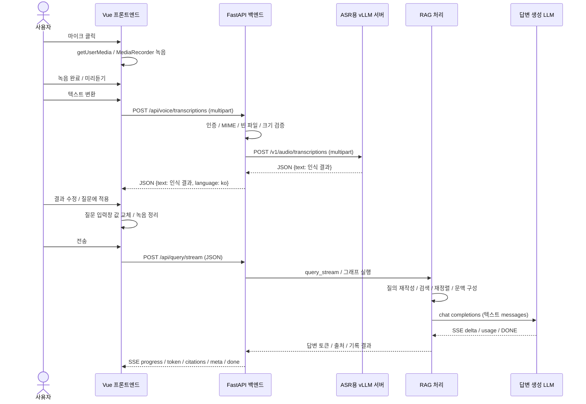

# STT 처리 흐름 및 요청·응답 상세

작성일: 2026-10-19. 현재 저장소의 실행 코드를 정적으로 확인한 결과다. 실제 마이크, 운영 백엔드 및 vLLM 서버를 호출해 확인한 결과는 아니다. 아래 음성 내용, 파일명, 서버 주소 및 응답 데이터는 계약 설명을 위한 예시이며, 설정값은 코드 기본값과 구분해 표기한다.

## 1. 핵심 구조

프론트엔드에서는 마이크 음성을 **녹음**한다. 실제 음성 인식(STT)은 백엔드가 별도 ASR 서버의 OpenAI 호환 API를 호출해 수행한다. 기본 ASR 모델은 `Qwen/Qwen3-ASR-1.7B`다.

녹음 완료 → 미리듣기 → 사용자가 텍스트 변환 요청 → 인식 결과 확인·수정 → 질문에 적용 → 기존 채팅 전송의 순서다. 녹음 완료, 텍스트 변환 완료, 질문 적용 시점에 자동으로 RAG 질의를 실행하지 않는다.



ASR 서버와 답변 생성 서버는 설정 및 API 목적이 구분된다. 음성 파일은 ASR API로 보내며, 답변 생성 LLM에는 적용 후 전송한 질문과 검색 문맥을 텍스트로 보낸다. 답변 모델로 OpenAI를 선택할 수도 있으며, 질의 재작성 단계는 로컬 LLM을 사용한다.

## 2. 단계별 실행 함수

| 단계 | 파일 / 함수 | 실행 내용 |
|---|---|---|
| 화면 초기화 | `ChatView.vue` → `useVoiceRecorder()` | 음성 상태와 UI 연결 |
| 녹음 버튼 | `ChatView.vue` → `toggleVoiceRecording()` | 녹음 시작·중지 연결 |
| 녹음 시작 | `useVoiceRecorder.js` → `startRecording()` | 기존 결과 정리, 브라우저 지원 검사, 마이크 권한 요청, MediaRecorder 생성 |
| 형식 선택 | `chooseMimeType()` | 브라우저가 지원하는 MIME 후보 중 첫 항목 선택 |
| 레벨 표시 | `prepareMeter()` → `updateMeter()` | AudioContext/Analyser로 RMS 계산, 파형 수준 및 무음 안내 갱신 |
| 시간 제한 | `startTimer()` → `stopRecording()` | 200ms마다 경과 시간 확인, 60초 도달 시 중지 |
| 파일 생성 | `dataavailable` 이벤트 → `finishRecording()` | 청크를 Blob으로 합치고 File 및 미리듣기 URL 생성 |
| 변환 요청 | `transcribeRecording()` → `buildUploadFormData()` | 파일과 언어·시간을 multipart 데이터로 구성 |
| 프론트 API | `voiceApi.transcribe()` → `http.post()` | JWT와 함께 백엔드 업로드 API 호출 |
| 인증 | `get_current_principal()` | 사용자 또는 관리자 JWT 검증 |
| 백엔드 라우트 | `voice.py` → `create_transcription()` | 파일 검사 후 ASR 클라이언트 호출 |
| ASR 호출 | `VoiceAsrClient.transcribe()` | 파일 필드를 `audio`에서 `file`로 바꾸어 ASR 서버에 전달 |
| ASR 응답 처리 | `VoiceAsrClient.transcribe()` | HTTP 상태·JSON·text 검증, 앞뒤 공백 제거 |
| 화면 결과 반영 | `transcribeRecording()` | `transcript`, `hasTranscription` 갱신, 편집 가능한 결과 표시 |
| 질문 적용 | `ChatView.vue` → `applyVoiceTranscript()` | `userInput`을 결과 텍스트로 교체하고 `dismissVoice()` 실행 |
| 채팅 전송 | `useChatView.js` → `sendStreamingMessage`(=`sendMessageStream`) | 기존 텍스트 질의 경로로 전송 |
| 채팅 HTTP | `chatStreamApi.send()` → `parseSSEStream()` | `/api/query/stream` 호출 및 SSE 파싱 |
| 백엔드 채팅 | `rag_query_stream()` → `RAGService.query_stream()` | 권한 및 모델 설정 처리 후 RAG 그래프 실행 |

파일 경로 기준: 프론트 화면은 `adrag_frontend/src/views/`, composable은 `adrag_frontend/src/composables/`, API는 `adrag_frontend/src/api/`에 있다. 백엔드 라우트는 `adrag_backend/app/routes/`, 클라이언트는 `adrag_backend/app/clients/`에 있다.

## 3. 프론트엔드 녹음 파일 형식

`useVoiceRecorder.js`의 `MIME_TYPE_CANDIDATES` 순서대로 지원 여부를 확인한다.

| 우선순위 | MIME 후보 | 생성 확장자 |
|---|---|---|
| 1 | `audio/webm;codecs=opus` | `.webm` |
| 2 | `audio/mp4` | `.m4a` |
| 3 | `audio/ogg;codecs=opus` | `.ogg` |
| 4 | `audio/webm` | `.webm` |

지원 후보가 없으면 MIME을 지정하지 않고 `new MediaRecorder(mediaStream)`으로 브라우저 기본 형식을 사용한다. 완료 시 MIME은 `mediaRecorder.mimeType`, 첫 청크의 type, `audio/webm` 순서로 결정한다. 확장자 매핑 함수는 mp4이면 m4a, ogg이면 ogg, 나머지는 webm을 반환한다.

- 파일명: `voice_question_YYYYMMDD_HHMMSS.<확장자>`.
- 예: `voice_question_20261019_143000.webm`.
- 녹음 옵션: echoCancellation, noiseSuppression, autoGainControl 활성화 및 `channelCount: 1` 요청. 실제 장치 적용 결과는 별도 확인하지 않는다.
- `mediaRecorder.start(250)`의 250ms는 청크 수집 간격이다. 청크마다 서버에 전송하는 구조가 아니다.
- 샘플레이트·비트레이트를 코드에서 명시하지 않는다.
- 최대 녹음 길이는 프론트 기준 60초다.
- RMS 임계값은 0.018이며, 3초간 기준 이상 입력이 없으면 안내만 표시한다. 무음으로 자동 종료하지 않는다.
- 완료 후 `new Blob(chunks, {type})` → `new File(...)` → `URL.createObjectURL(blob)` 순서로 파일과 미리듣기 URL을 만든다.
- STT 업로드 전에 WAV/PCM 변환, 리샘플링, Base64 인코딩을 수행하지 않는다.

## 4. 프론트엔드 → 백엔드 요청

호출 경로: `transcribeRecording()` → `buildUploadFormData()` → `voiceApi.transcribe()`.

```http
POST /api/voice/transcriptions
Authorization: Bearer <로그인 JWT>
Content-Type: multipart/form-data; boundary=<브라우저 생성값>
```

| multipart 필드 | 형식 | 값 / 처리 |
|---|---|---|
| `audio` | 바이너리 File | 녹음 파일, 원본 파일명 및 MIME 포함 |
| `language` | 문자열 | 현재 프론트는 `ko` 고정 |
| `duration_ms` | 문자열 | 녹음 경과 시간. 예: `8500` |

`http`의 baseURL은 `/api`, API 함수 경로는 `/voice/transcriptions`다. `authConfig()`는 sessionStorage의 `admin_token` 또는 `user_token`을 Bearer 헤더로 구성한다. 프론트 요청 timeout은 35,000ms이며 AbortController의 signal을 전달한다.

**`duration_ms`는 현재 백엔드 라우트의 인자로 선언되어 있지 않아 사용·검증·ASR 전달되지 않는다.** `language`는 백엔드에서는 선택 필드다.

## 5. 백엔드 검증 및 처리

`main.py`에서 voice router를 `/api` 하위에 등록한다. `voice.py`의 router prefix는 `/voice`다.

`create_transcription()`이 처리하는 내용:

1. Depends의 `get_current_principal()`로 JWT 인증. `admin_access`, `user_access`를 허용한다.
2. `audio.content_type`에서 `;` 이후 옵션을 제거하고 소문자로 바꾼다. 예: `audio/webm;codecs=opus` → `audio/webm`.
3. MIME 허용 목록 검사: `audio/mpeg`, `audio/mp4`, `audio/ogg`, `audio/wav`, `audio/webm`.
4. `await audio.read()`로 전체 파일을 bytes로 읽는다.
5. 빈 데이터 검사 및 `voice_max_upload_bytes` 초과 검사. 기본 상한은 10 MiB(10,485,760 bytes)다.
6. ASR 클라이언트 존재 여부 확인. `VOICE_ASR_API_URL`이 없으면 503이다.
7. `VoiceAsrClient.transcribe(payload, filename, content_type, language=language)` 호출. 파일명이 없으면 `recording.webm` 사용.
8. 성공하면 `{"text": text, "language": language}` 반환.

현재 검증은 MIME 문자열·빈 데이터·바이트 크기 기준이다. 오디오 디코딩으로 실제 포맷이나 재생 시간을 확인하지 않으며, 크기 검사도 전체 read 이후에 수행한다. STT 라우트에는 컬렉션 선택이나 문서 검색 로직이 없다.

## 6. 백엔드 → ASR용 vLLM 요청

`VoiceAsrClient`는 설정을 주입받는다.

| 설정 | 코드 기본값 / 동작 |
|---|---|
| `VOICE_ASR_API_URL` | 기본 None. 없으면 STT 비활성화 |
| `VOICE_ASR_MODEL_NAME` | `Qwen/Qwen3-ASR-1.7B` |
| `VOICE_ASR_API_KEY` | 없으면 `VLLM_API_KEY` 사용 |
| `VOICE_ASR_TIMEOUT` | 30초 |
| `VOICE_MAX_UPLOAD_BYTES` | 10 × 1024 × 1024 |

URL 생성은 `transcription_url` property가 담당한다. 끝의 `/`를 제거하고, base URL이 `/v1`로 끝나면 `/audio/transcriptions`를 추가하며, 그렇지 않으면 `/v1/audio/transcriptions`를 추가한다.

예시:

```text
http://asr.internal:8007
  → http://asr.internal:8007/v1/audio/transcriptions
http://asr.internal:8007/v1
  → http://asr.internal:8007/v1/audio/transcriptions
```

실제 HTTP 호출 구조:

```python
await get_shared_async_client().post(
    self.transcription_url,
    data={"model": self.model, "language": "ko"},
    files={"file": (filename, audio_bytes, normalized_content_type)},
    headers={"Authorization": f"Bearer {self.api_key}"},
    timeout=self.timeout,
)
```

`language` 값이 없으면 data에서도 생략된다. Content-Type과 multipart boundary는 httpx가 구성한다. 브라우저 로그인 JWT를 ASR 서버로 전달하는 방식이 아니라 서버 설정의 ASR 키로 인증한다.

| 항목 | 브라우저 → 백엔드 | 백엔드 → ASR |
|---|---|---|
| HTTP body | multipart/form-data | multipart/form-data |
| 파일 필드명 | `audio` | `file` |
| 파일 내용 | 녹음 바이너리 | 같은 bytes, 별도 포맷 변환 없음 |
| MIME | 코덱 옵션이 있을 수 있음 | `;` 이후 옵션 제거 |
| 언어 | `language=ko` | 값이 있으면 전달 |
| 모델 | 전송 안 함 | 설정의 `model` 추가 |
| 녹음 시간 | `duration_ms` 전달 | 전송 안 함 |
| 인증 | 로그인 JWT | ASR 전용 키 또는 공용 vLLM 키 |

이 요청에는 `messages`, 프롬프트, `temperature`, `response_format`, `stream`, `timestamp_granularities`를 명시하지 않는다. ASR 자동 재시도나 다른 STT 모델로의 전환도 구현하지 않는다.

## 7. ASR 응답 → 백엔드 → 프론트엔드

ASR 클라이언트가 요구하는 최소 응답 형식은 다음 JSON이다.

```json
{"text": "보호구 착용 기준을 알려줘"}
```

`VoiceAsrClient.transcribe()`는 다음 순서로 처리한다.

1. `response.raise_for_status()`로 HTTP 오류 확인.
2. `response.json()` 파싱.
3. 응답이 dict이며 `text`가 문자열인지 확인.
4. `text.strip()`이 비어 있지 않은지 확인.
5. 정리한 문자열만 라우트에 반환.

다른 응답 필드가 있더라도 현재 앱에서는 사용하지 않는다. 신뢰도, 구간별 타임스탬프, 화자 정보, 인식 언어를 별도 추출하지 않는다.

백엔드가 프론트로 반환하는 JSON 예:

```json
{
  "text": "보호구 착용 기준을 알려줘",
  "language": "ko"
}
```

여기서 `language`는 **ASR의 자동 감지 결과가 아니라 입력받은 language를 그대로 돌려주는 값**이다. 생략 요청이면 null이 될 수 있다. 응답에 음성 파일이나 음성 다운로드 URL은 포함하지 않는다.

프론트의 `transcribeRecording()`은 `data.text`를 다시 trim한 후 `transcript`에 저장하고 `hasTranscription=true`로 전환한다. UI는 textarea의 `v-model="voiceTranscript"`로 수정 가능하게 표시한다. 변환 중에도 녹음 파일·미리듣기를 유지하며, 실패 후 같은 파일로 다시 변환할 수 있다.

`applyVoiceTranscript()`는 수정된 결과를 trim하고, `chatView.userInput.value = text`로 **기존 질문 입력값을 교체**한다. 이어 `dismissVoice()`로 패널과 녹음 자원을 정리한다. 기존 입력 뒤에 덧붙이지 않으며 자동 전송하지 않는다.

## 8. 질문 전송 이후의 RAG 및 vLLM 흐름

이 단계는 사용자가 기존 채팅 전송 버튼을 누른 뒤에만 시작된다. STT 결과는 일반 텍스트 질문과 같은 경로로 처리된다.

### 8.1 프론트 질문 요청

`sendStreamingMessage`는 `sendMessageStream`의 별칭이다. `chatStreamApi.send()`가 다음 JSON을 전송한다.

```http
POST /api/query/stream
Authorization: Bearer <로그인 JWT>
Content-Type: application/json
```

```json
{
  "query": "보호구 착용 기준을 알려줘",
  "collection_name": "<선택한 컬렉션>",
  "llm_provider": "local",
  "llm_model": "<선택한 모델 ID>"
}
```

OpenAI API 키 입력값이 있으면 `openai_api_key`도 추가한다. 이 요청에는 오디오, 원본 transcript, 녹음 시간, STT 모델명, 수정 여부, `input_mode`를 포함하지 않는다.

### 8.2 백엔드 함수 및 그래프

`rag_query_stream()`은 사용자와 컬렉션 접근 권한을 검사하고 필요한 모델 API 키를 해석한 뒤 `RAGService.query_stream()`을 `StreamingResponse`로 반환한다. 내부 `_query_stream_from_graph()`는 그래프의 `astream_events(state, version="v2")`를 소비한다.

정상 경로의 그래프 함수 순서:

```text
validate_input()
  → guardrail()
  → analyze_and_rewrite()
  → build_metadata_filter()
  → retrieve()
  → rerank()
  → assemble_context()
  → generate_answer()
  → format_citations()
  → build_response()
```

입력 검증·가드레일·필터·검색 오류는 `build_response`로 조기 종료할 수 있다. 관련성 부족 또는 생성 문제는 `fallback_handler()`로 분기하며, 조건에 따라 검색·생성을 다시 수행하거나 종료한다. 따라서 모든 요청에서 위 단계가 끝까지 실행되는 것은 아니다.

| 처리 목적 | 호출 / 주요 데이터 |
|---|---|
| 질의 재작성 | `analyze_and_rewrite()` → 로컬 `LLMService.chat()` → `/v1/chat/completions`. 텍스트 응답의 JSON에서 `rewritten_queries` 추출 |
| 검색용 임베딩 | `EmbeddingClient` → `/v1/embeddings`. JSON의 `model`, `input`(문자열 목록), 설정에 따른 `truncate_prompt_tokens`. 응답의 `data[].embedding` 사용 |
| 문서 검색 | `retrieve()` 및 retrieval orchestrator가 검색 설정에 따라 벡터 저장소 검색 수행 |
| 관련성 점수 | `rerank()` → RerankerClient → `/v1/score`. JSON의 `model`, `text_1`(질문), `text_2`(문서 목록) 등 전달. 응답 `data[].index`, `data[].score` 검증 후 사용 |
| 답변 문맥 | `assemble_context()`가 검색 청크를 답변용 문맥으로 구성 |
| 답변 생성 | `generate_answer()` → `build_rag_messages()` → `LLMService.chat_stream()` |

임베딩·재정렬·ASR·답변 LLM은 각각 목적과 설정을 가진 서버 호출이다. 동일한 vLLM이라는 이름이 있어도 같은 모델 API에 모두 보내는 구조가 아니다.

### 8.3 로컬 답변 생성 vLLM 요청·응답

`generate_answer()`는 `original_query`, `final_context`, 사용 가능한 인용 번호로 `build_rag_messages()`를 호출한다. 로컬 모델 선택 시 `LLMClient.chat_stream()`이 다음 형태로 요청한다.

```http
POST <VLLM_API_URL>/v1/chat/completions
Authorization: Bearer <VLLM_API_KEY>
Content-Type: application/json
```

```json
{
  "model": "<VLLM_MODEL_NAME>",
  "messages": [
    {"role": "system", "content": "<RAG 시스템 지침>"},
    {"role": "user", "content": "<질문·검색 문맥·인용 지침으로 구성된 내용>"}
  ],
  "temperature": "<설정의 숫자값>",
  "max_tokens": "<설정의 정수값>",
  "stream": true,
  "stream_options": {"include_usage": true},
  "chat_template_kwargs": {"enable_thinking": false},
  "stop": ["</think>", "Thinking Process:"]
}
```

위 temperature/max_tokens의 문자열은 자리표시자다. 실제 전송값은 숫자이며, 메시지 본문도 템플릿이 구성한 실제 문자열이다.

수신하는 SSE의 소비 필드 예:

```text
data: {"choices":[{"delta":{"content":"보호구는 "}}]}

data: {"choices":[{"delta":{"content":"작업 조건에 따라 착용해야 합니다.[1]"}}]}

data: {"choices":[],"usage":{"prompt_tokens":1000,"completion_tokens":80,"total_tokens":1080}}

data: [DONE]
```

`LLMClient.chat_stream()`은 `data: ` 라인을 전달한다. `LLMService.chat_stream()`이 JSON의 `choices[0].delta.content`를 추출하고 usage를 수집하며, `<think>...</think>` 내용은 필터링한다. `generate_answer()`는 텍스트를 누적하고 `adispatch_custom_event("rag_token", {"token": token})`으로 그래프 이벤트를 발생시킨다.

### 8.4 백엔드 → 프론트 채팅 응답

백엔드는 원본 vLLM SSE를 그대로 전달하지 않고 앱 전용 이벤트로 구성한다.

```text
data: {"type":"progress","stage":"searching"}

data: {"type":"progress","stage":"generating"}

data: {"type":"token","content":"보호구는 ..."}

data: {"type":"citations","data":[]}

data: {"type":"meta","log_id":123}

data: {"type":"done"}
```

출처가 있으면 citations 배열에 해당 데이터가 들어간다. meta는 기록된 log_id가 있을 때 전송한다. 실패 시 error 이벤트가 발생할 수 있고, 조기 종료·폴백에 따라 progress/token 구성은 달라질 수 있다.

`parseSSEStream()`이 이벤트를 파싱하고 `sendMessageStream()`의 onEvent가 답변 텍스트를 누적하여 화면에 렌더링한다. citations는 출처 패널, meta의 log_id는 피드백 대상 메시지에 연결한다. 일반 질의 이력 및 로그 기록과 STT 원본 기록은 서로 다른 범위다.

## 9. 오류 및 취소 처리

| 상황 | 백엔드 결과 | 프론트 동작 |
|---|---|---|
| 인증 누락·만료·잘못된 유형 | 401 | 재로그인 안내 |
| 허용하지 않는 MIME | 415 | 일반 인식 실패 안내 |
| 빈 파일 | 400 | 일반 인식 실패 안내 |
| 업로드 크기 초과 | 413 | 짧게 다시 녹음하도록 안내 |
| ASR URL 미설정 | 503 | 서버 미설정·사용 불가 안내 |
| ASR HTTP 오류·네트워크 오류·timeout | 502 | 일반 인식 실패 안내 |
| ASR JSON 오류·빈 text·잘못된 text 타입 | 502 | 일반 인식 실패 안내 |
| 프론트 Axios timeout | `ECONNABORTED` | 인식 시간 초과 안내 |
| 중간 프록시 등이 504 반환 | 504 | 인식 시간 초과 안내 |

중요: 백엔드의 ASR timeout은 httpx.HTTPError → VoiceAsrError → 502로 합쳐진다. 따라서 프론트가 시간 초과 전용 문구를 가지고 있어도, 현재 백엔드가 30초 ASR timeout을 504로 구분해 주는 것은 아니다.

`clearRecording()`은 진행 중인 AbortController를 abort하고 transcript·파일·시간·객체 URL을 정리한다. `transcribeRecording()`은 응답 도착 후 signal.aborted를 확인하여 취소된 결과를 적용하지 않는다. `finally`도 같은 controller인지 확인해 이전 요청이 새 요청의 로딩 상태를 덮어쓰지 않도록 한다.

닫기, 재녹음, 주제 변경 및 화면 정리 시 녹음/요청 취소 처리가 연결되어 있다. `onBeforeUnmount(cancelRecording)`으로 마이크 트랙·타이머·AudioContext 등을 정리한다. 프론트 요청 취소가 이미 시작된 ASR 서버의 추론 중단까지 보장하는 별도 서버 취소 프로토콜은 구현되어 있지 않다.

## 10. 저장 범위와 현재 한계

- STT 라우트에는 음성 원본을 영구 파일이나 DB로 저장하는 로직이 없다. UploadFile을 bytes로 읽어 외부 ASR 호출에 사용한다. 웹 프레임워크의 임시 업로드 버퍼 사용과 영구 보관은 구분해야 한다.
- 브라우저의 녹음 File·Blob URL은 적용·취소·재녹음 시 정리한다.
- STT 전용 DB 저장, 원문과 수정본 연결, 수정 여부 및 input_mode 기록은 현재 STT 실행 경로에 없다.
- 채팅 전송 이후에는 일반 질문과 답변 이력·로그가 저장될 수 있지만 STT 원본 음성 및 인식 이력 기록을 대신하지는 않는다.
- 음성 길이 서버 검증, 1초 미만 차단, 전문 용어 사전 보정, 인식 신뢰도 표시, 실시간 부분 인식, 자동 질문 전송은 현재 흐름에 없다.
- 현재 STT 경로에는 TTS 응답 생성·재생 API 호출이 없다. 녹음 미리듣기는 사용자가 녹음한 원본 오디오 재생이다.
- 실제 활성 서버 주소·모델 및 환경변수 override는 이 문서에서 검증하지 않았다. ASR 클라이언트는 모듈 초기화 시 생성되므로 설정 변경 적용에는 백엔드 재시작이 필요하다.

## 11. 확인한 근거 파일 및 테스트 범위

주요 구현:

- `adrag_frontend/src/composables/useVoiceRecorder.js`
- `adrag_frontend/src/views/ChatView.vue`
- `adrag_frontend/src/api/voiceApi.js`, `http.js`, `chatStreamApi.js`
- `adrag_frontend/src/composables/useChatView.js`
- `adrag_backend/main.py`
- `adrag_backend/app/routes/voice.py`, `query.py`
- `adrag_backend/app/clients/voice_asr_client.py`, `llm_client.py`, `embedding_client.py`, `reranker_client.py`
- `adrag_backend/app/core/config.py`, `http.py`
- `adrag_backend/app/utils/security.py`
- `adrag_backend/app/services/rag_service.py`, `llm_service.py`
- `adrag_backend/app/graphs/rag_graph.py`, `nodes/analyze_and_rewrite.py`, `nodes/generate_answer.py`
- `adrag_backend/app/prompts/templates.py`

기존 테스트 코드에서 확인한 범위:

- `adrag_backend/tests/test_voice_asr_client.py`: multipart 필드·URL·인증 계약, 빈 결과 거부, `/v1` 중복 방지.
- `adrag_backend/tests/test_voice_routes.py`: 정상 전달, 인증, MIME, 빈 파일, ASR 미설정 및 ASR 실패.
- `adrag_frontend/tests/voiceTranscription.test.mjs`: 인식 결과 적용 준비, 재시도 및 취소 결과 무시 관련 테스트 존재.

문서 작성 과정에서는 테스트를 새로 실행하지 않았다. 기존 테스트 및 `phase-stt-first.md`의 과거 검증 기록을 현재 서버의 동작 보장으로 간주하지 않는다.

## 12. 형식별 실측 (2026-10-20 추가)

dev 컨테이너에서 ASR용 vLLM 서버(`VOICE_ASR_API_URL`, Qwen3-ASR-1.7B)에 백엔드 `VoiceAsrClient`와 같은 요청(multipart `file`·`model`·`language=ko`)을 직접 보냈다. 원본은 저장소의 `adrag_backend/asr_test.wav`(16kHz 모노 PCM, 9초)이고, WSL ffmpeg로 브라우저 녹음과 같은 형식으로 바꿨다. 실제 브라우저 녹음 파일은 아니다(형식·코덱·컨테이너 구조를 흉내 냄).

| 흉내 낸 대상 | 파일 | 보낸 MIME | 결과 |
|---|---|---|---|
| Chrome·Edge | webm/Opus 48kHz 모노 | `audio/webm` | 200, 0.2초, 정상 인식 |
| Chrome 실제 녹음 형태(길이 정보 없는 스트리밍 webm) | webm/Opus `-live` | `audio/webm` | 200, 정상 |
| Firefox(후보 3) | ogg/Opus | `audio/ogg` | 200, 정상 |
| Safari | 조각난 mp4/AAC | `audio/mp4` | 200, 정상 |
| 일반 m4a | mp4/AAC | `audio/mp4` | 200, 정상 |
| 참고 | wav PCM 16kHz | `audio/wav` | 200, 정상 |
| 참고 | mp3 | `audio/mpeg` | 200, 정상 |
| MIME 불일치 | webm 내용 + `audio/wav`, mp4 내용 + `audio/webm`, `application/octet-stream` | | 모두 200, 정상 → ASR 서버는 MIME이 아니라 **파일 내용으로 형식 판단** |
| 최대 녹음 길이 | webm/Opus 63초(254KB) | `audio/webm` | 200, 0.6초, 265자 정상 |

- 7개 형식 모두 같은 인식 결과(37자). 백엔드·프런트에서 WAV 변환이 필요 없다는 것을 확인했다.
- 크기: 60초 Opus ≈ 0.25MB, AAC ≈ 0.5MB → 백엔드 한도 `VOICE_MAX_UPLOAD_BYTES`(10MB)·ASR 서버 `VLLM_MAX_AUDIO_CLIP_FILESIZE_MB`(50)보다 훨씬 작다.
- 실제 마이크·브라우저(Chrome·Safari) 녹음으로 끝까지 확인하는 것은 남아 있다(Phase 4.5 시험 항목).
